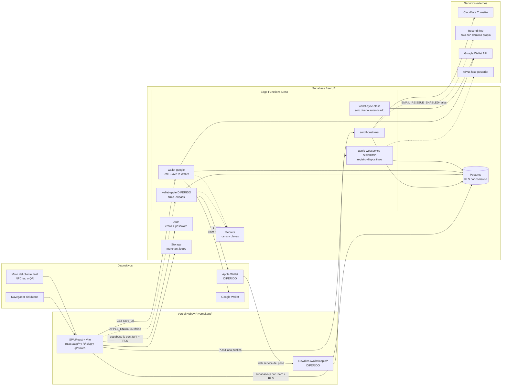
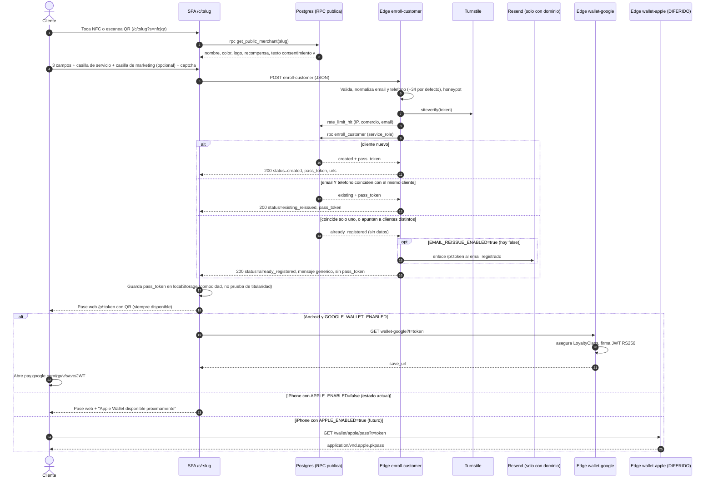

# ARCHITECTURE: FidelityCard (MVP actual)

**Estado**: Propuesto | **Autor**: Arquitectura | **Fecha**: 2026-10-20 | **Versión**: 0.2 (decisiones del dueño: Apple aparcado, dominio y servicios gratuitos)
**Alcance que cubre este documento** (decisión del dueño, prevalece sobre el PRD):

1. Alta/login de comercio y panel mínimo: configura su tarjeta (VISITAS o PUNTOS, umbral X, recompensa, nombre/color/logo) y obtiene URL, QR y enlace NFC.
2. Cliente final entra por NFC o QR (ambos abren `/c/:slug`), rellena nombre, email, teléfono + consentimiento RGPD y recibe su **pase web `/p/:token` con QR** y, después, el botón de **Google Wallet**. **Apple Wallet está aparcado** (sección 0).

**Fuera de alcance ahora**: sumar visitas/puntos, canje, vista de caja, KPIs. El modelo y los contratos dejan la puerta abierta (sección 8) sin migraciones destructivas.

## 0. Decisiones vigentes del dueño (prevalecen sobre el resto del documento)

| # | Decisión | Consecuencia arquitectónica |
|---|---|---|
| D1 | **Apple Wallet aparcado**: no hay cuenta Apple Developer. `APPLE_ENABLED=false` por defecto. | Orden: pase web `/p/:token` con QR, luego Google Wallet, luego Apple (futuro). Apple fuera del camino crítico; spike de Apple **diferido**. Ver sección 4. |
| D2 | **Dominio gratuito `*.vercel.app`**. Resend (plan gratuito) no puede verificar un dominio `.vercel.app`, así que no envía a clientes reales hasta tener dominio propio. | Cliente ya registrado: re-emisión del pase si coinciden **email Y teléfono** (sin email); si no, respuesta genérica sin datos. El enlace por email queda diseñado tras `EMAIL_REISSUE_ENABLED=false`. ADR-008 y ADR-010. |
| D3 | **Capa gratuita**: Supabase free (UE), Turnstile free, Resend free, Vercel Hobby. | Límites y mitigaciones en 5.3. Vercel Hobby es de uso **no comercial**: revisar antes de cobrar. |
| D4 | Casilla de **marketing separada** (opcional, no premarcada) del consentimiento básico. País por defecto del teléfono **+34 (España)**. | Contrato 3.1, ADR-008. |
| D5 | **Revisión legal pospuesta**. | El texto RGPD de UX.md/DATA-MODEL.md es **borrador**. Riesgo: dar de alta clientes reales con un texto sin revisar expone al comercio y a FidelityCard a incumplimiento del RGPD. |
| D6 | **Nombre unificado** de la RPC pública: `get_public_merchant(slug)` (DATA-MODEL.md). | Sustituye a `public_card_by_slug` en todo el documento. |

> Este documento define arquitectura y contratos. El esquema de tablas detallado vive en `docs/DATA-MODEL.md`; aquí solo se fijan las **restricciones arquitectónicas** que el esquema debe cumplir (sección 2.7). Si hay conflicto de nombres, manda DATA-MODEL.md.

---

## 1. Diagramas

### 1.1 Componentes



### 1.2 Alta del cliente y generación del pase



---

## 2. Decisiones de arquitectura (ADR)

### ADR-001: Stack

**Estado**: Aceptado. **Contexto**: JavaScript (no TS) + React + Supabase obligatorios; Vite/Tailwind/Vercel sugeridos; equipo pequeño; 1 desarrollador probable.

**Decisión**

| Capa | Elección | Notas |
|---|---|---|
| UI | React 18/19 + Vite (JS, JSX) | SPA. Validado. |
| Estilos | Tailwind CSS (v4 con plugin de Vite; v3.4 si hay fricción con el tooling) | Validado. Sin librería de componentes pesada; componentes propios mínimos (Button, Field, Card). |
| Routing | `react-router` en modo librería (SPA) | Ver ADR-003. |
| Datos | `@supabase/supabase-js` + TanStack Query | Query solo para el panel; la landing pública usa `fetch` simple para no inflar el bundle. |
| Formularios | `react-hook-form` + `zod` (JS puro) | Validación en cliente; la autoridad es el servidor. |
| QR | `qrcode` (SVG/PNG en cliente) | Genera el QR del panel sin servicio externo. |
| Teléfonos | `libphonenumber-js` (cliente y Edge Function) | Normalización E.164, país por defecto **ES (+34)**: sin prefijo se interpreta como español; con prefijo internacional válido se acepta. |
| Backend | Postgres + RLS + RPC SQL + Edge Functions (Deno) | Sin servidor propio. |
| Hosting | Vercel **Hobby** (SPA, `*.vercel.app`) + Supabase **free** (región UE) | Validado por el dueño. Límites y uso no comercial en 5.3. |
| Email | Resend **free** (API; SMTP de Auth solo con dominio) | Sin dominio propio Resend no puede enviar a terceros: el email queda tras `EMAIL_REISSUE_ENABLED=false` (ADR-008, ADR-010). |
| Captcha | Cloudflare Turnstile (free) | Gratis, sin fricción, más amable con RGPD que reCAPTCHA. |
| Calidad | ESLint + Prettier, Vitest, pgTAP (`supabase test db`), Deno test, Playwright (E2E, fase 5) | pgTAP es obligatorio para RLS. |

**Tipado sin TypeScript**: JSDoc en contratos (`@typedef`) + `// @ts-check` opcional en editor para `src/lib/` y funciones. No se compila TS.

**Alternativas descartadas**
- *Next.js*: aporta SSR que no necesitamos (la landing no requiere SEO; los datos son de una sola RPC) y añade un segundo runtime de servidor junto a Supabase. Se descarta por complejidad, es reversible si algún día hay marketing/SEO.
- *Servidor Node propio para pases*: ver ADR-004.

**Consecuencias**: stack mínimo y barato; el coste es no tener tipos fuertes (mitigado con JSDoc, zod en bordes y tests de contrato).

---

### ADR-002: Estructura de carpetas del repo

**Decisión**: un solo repo, Vite en la raíz (Vercel lo autodetecta), Supabase en `supabase/`.

```
FidelityCard/
├── docs/                      PRD, UX, DATA-MODEL, ARCHITECTURE
├── public/                    favicon, manifest PWA de la pagina de pase
├── src/
│   ├── main.jsx
│   ├── app/                   router.jsx, providers, guards (RequireAuth)
│   ├── lib/                   supabase.js, env.js, format.js, contrast.js, phone.js
│   ├── features/
│   │   ├── auth/              Login, Signup, Recover
│   │   ├── merchant/          Onboarding, ajustes legales/RGPD
│   │   ├── card-config/       Wizard tarjeta, preview del pase, subida de logo
│   │   ├── share/             URL, QR, enlace NFC, descarga del QR
│   │   ├── enroll/            Landing /c/:slug, formulario, exito
│   │   └── pass/              /p/:token, pase web, botones de wallet
│   ├── components/ui/         primitivas visuales
│   └── styles/
├── supabase/
│   ├── config.toml            verify_jwt por funcion
│   ├── migrations/            SQL versionado (solo aditivo tras el piloto)
│   ├── seed.sql               comercio demo para local
│   ├── tests/                 pgTAP: RLS, idempotencia, rate limit
│   └── functions/
│       ├── _shared/           cors.js, errors.js, validate.js, rate-limit.js,
│       │                      turnstile.js, email.js, pass-model.js, tokens.js
│       ├── enroll-customer/
│       ├── wallet-apple/      pkpass.js (zip + manifest + firma)
│       ├── wallet-google/     jwt.js, google-api.js
│       ├── apple-webservice/
│       └── wallet-sync-class/
├── .github/workflows/         ci.yml (lint + test), deploy.yml
├── .env.example
├── vercel.json                rewrites SPA + /wallet/apple/* + cabeceras de seguridad
└── package.json
```

**Reglas de dependencia** (las del rol de arquitecto, aplicadas sin ceremonia): `features/*` no se importan entre sí (solo vía `lib/` y `components/`); las Edge Functions comparten solo `_shared/`; `_shared/pass-model.js` construye un **modelo neutro de pase** (campos, colores, textos) que consumen por separado el generador Apple y el de Google. Así los cambios de wallet no tocan el dominio. No hay capa "repository": CRUD directo con supabase-js + RLS es suficiente (dominio casi CRUD; DDD no se justifica en este alcance).

---

### ADR-003: Routing

**Decisión**: SPA con `react-router`; code splitting por ruta.

| Ruta | Acceso | Descripción |
|---|---|---|
| `/` | público | Redirige a `/login` (landing de marketing fuera de alcance) |
| `/login`, `/signup`, `/recover` | público | Auth del comercio |
| `/app` | auth | Redirige a onboarding o a la tarjeta |
| `/app/onboarding` | auth | Crea comercio (`create_merchant`) |
| `/app/card` | auth | Configuración de tarjeta + preview + activar |
| `/app/share` | auth | URL, QR, enlace NFC |
| `/app/settings` | auth | Datos legales (responsable RGPD), logo, nombre |
| `/c/:slug` | **público** | Landing de alta (NFC y QR). Query `?s=nfc|qr|link` solo para atribución |
| `/c/:slug/privacidad` | público | Política de privacidad del comercio (responsable) |
| `/p/:token` | público con token | Pase web (QR) + botones de wallet; también recuperación y Plan B |

**Decisiones clave**
- **Un solo `/c/:slug` para NFC y QR.** La fuente se distingue por `?s=` (la etiqueta NFC se programa con `?s=nfc`, el QR descargable con `?s=qr`). Si el parámetro falta, `link`.
- **El slug es inmutable** una vez creado: queda grabado en etiquetas físicas. Formato `nombre-comercio-xxxx` (4-5 caracteres aleatorios para evitar colisiones y adivinación trivial). Si algún día debe cambiar, se mantiene un histórico (`slug_aliases`) y se redirige; no se hace en MVP.
- **El bundle de `/c/:slug` debe ser mínimo** (objetivo PRD: <2 s en 4G): rutas con `React.lazy`, sin importar TanStack Query ni librerías del panel; Turnstile se carga solo en esa ruta. Presupuesto orientativo: <120 kB gzip JS en la landing.
- `vercel.json`: rewrite de fallback a `index.html`, y cabeceras (CSP, `X-Content-Type-Options`, `Referrer-Policy: strict-origin-when-cross-origin`, `frame-ancestors 'none'`).

---

### ADR-004: Dónde se firma el pase Apple (.pkpass) y el JWT de Google

> **Apple DIFERIDO (D1)**: sin cuenta Apple Developer no hay certificado. Todo lo de Apple en este ADR y en 3.2/3.4 es **diseño en reserva**, no se implementa en el MVP. Google sí entra (Edge Function, JWT RS256 con Web Crypto, sin dependencias).

**Contexto**: Apple exige zip con `pass.json`, imágenes, `manifest.json` (SHA-1 de cada fichero) y `signature` (PKCS#7 desprendido firmado con el certificado del Pass Type ID + WWDR intermedio). Google exige JWT RS256 con la clave de una service account y, para clases, llamadas REST con OAuth2 de service account.

| Opción | Pros | Contras |
|---|---|---|
| **A. Edge Functions de Supabase (Deno)** | Un solo plataforma, secretos junto a la BD, acceso a Postgres sin red extra, despliegue con CLI, ya previsto en el PRD | Compatibilidad de librerías npm/crypto en Deno; límites de CPU/tamaño por invocación (verificar en docs vigentes) |
| B. Función Node en Vercel (`/api`) | Node completo (passkit-generator, forge sin sorpresas) | Segundo sitio con secretos y credenciales de BD; más superficie |
| C. Servicio externo de pases (PassKit, etc.) | Rápido | Coste recurrente, dependencia, branding y datos de clientes fuera de la UE |

**Decisión**: **A (Edge Functions)** como camino por defecto, con **spike obligatorio antes de activar Apple (Fase D, diferida)**: firmar un .pkpass con certificado real de pruebas y abrirlo en un iPhone físico. Ya **no** está en la Fase 0. Si el spike falla, **B** es el plan de contención: el contrato HTTP (sección 3) no cambia, solo cambia quién lo sirve (rewrite de Vercel). Por eso la URL del pase que ve el cliente es siempre de nuestro dominio (`/wallet/apple/...`), nunca la de Supabase directamente.

**Detalles de implementación**
- **Generación al vuelo, sin almacenar .pkpass**: cada descarga construye el pase desde la BD (estado actual). Evita ficheros obsoletos y facilita las actualizaciones futuras.
- **Apple**: zip con `fflate` (o equivalente ligero), SHA-1 con Web Crypto, firma PKCS#7 con `node-forge` vía `npm:` (o `passkit-generator`; se decide en el spike). Tipo de pase `storeCard`. Barcode `PKBarcodeFormatQR` con `message = serial`. Colores de fondo del comercio y color de texto calculado por contraste (WCAG) en `lib/contrast.js` / `_shared`.
- **Imágenes del pase**: el panel normaliza el logo en cliente (canvas, PNG cuadrado máx. 512 px). El mismo PNG sirve como `icon.png` y `logo.png` en el MVP (Apple lo escala); optimizar a @1x/@2x/@3x queda para después. Se rechaza SVG (riesgo XSS y no válido en pases).
- **`webServiceURL` + `authenticationToken` desde el primer pase** (punto importante): un pase emitido sin ellos **no se podrá actualizar nunca**. Como el MVP no actualiza saldos, es tentador omitirlos, pero entonces los pases de los pilotos quedarían huérfanos. Se incluyen siempre, y la Edge Function `apple-webservice` implementa desde el MVP solo lo barato: registrar/borrar dispositivos y servir el pase actual (`GET /v1/passes/...`). El envío de push por APNs queda para cuando exista el movimiento de saldo.
- **Google**: modelo "Loyalty". Una `LoyaltyClass` por tarjeta (`<issuerId>.<card_id>`), creada de forma idempotente de manera perezosa (en el primer `wallet-google`) y sincronizada desde el panel con `wallet-sync-class`. Un `LoyaltyObject` por cliente (`<issuerId>.<serial>`) incluido en un **JWT "skinny"** `savetowallet` (claims `iss`, `aud=google`, `typ=savetowallet`, `origins`, `payload.loyaltyObjects`). El enlace es `https://pay.google.com/gp/v/save/<JWT>`. Firma RS256 con Web Crypto (sin dependencias).
- **iOS**: el botón debe ser un **enlace de navegación** (`<a href>`), no `fetch`/blob; Safari solo ofrece "Añadir" si navega a una respuesta con `Content-Type: application/vnd.apple.pkpass`. Los navegadores embebidos (Instagram, WhatsApp) pueden no abrirlo: la página `/p/:token` indica "ábrelo en Safari".

**Consecuencias**: máxima simplicidad operativa; riesgo técnico concentrado y acotado (spike). Se acepta el límite de CPU de las Edge Functions: por eso no se redimensionan imágenes en la función.

---

### ADR-005: Secretos y certificados

**Decisión**
- **(Apple diferido)** Mientras `APPLE_ENABLED=false` no hay certificado Apple que custodiar; solo la service account de Google.
- **Un único certificado Apple de plataforma** (un Pass Type ID `pass.<dominio>` firma los pases de todos los comercios; supuesto 5 del PRD). El nombre del comercio aparece en el pase vía `organizationName`/`logoText`.
- **Generación de la CSR en la máquina del dueño** con `openssl`; la clave privada nunca viaja por chat ni se commitea. Del `.cer` descargado se obtienen `cert.pem` + `key.pem` (+ WWDR G4 en PEM).
- **Almacenamiento**: Supabase Secrets (`supabase secrets set`), valores en base64/PEM de una línea. Nunca en el repo, nunca en `VITE_*`, nunca en Vercel (el frontend no firma nada). Una copia cifrada de respaldo en el gestor de contraseñas del dueño.
- **Separación por entorno**: Pass Type ID y service account de Google distintos para `dev/staging` y `prod`. Rotación documentada en un runbook.
- **Caducidad**: el certificado de Pass Type ID **caduca (orden de 1 año)**; recordatorio en calendario 30 días antes. Con el certificado caducado no se pueden emitir ni actualizar pases. La clave de Google puede rotarse sin afectar a pases ya emitidos.
- **Service role key** solo dentro de Edge Functions (inyectada por Supabase). Cualquier función pública usa clientes con el mínimo privilegio posible.
- **Logs sin PII ni secretos**: se registra `request_id`, `merchant_id`, códigos de error; nunca email/teléfono completos ni tokens.

Variables concretas en la sección 5.

---

### ADR-006: Multi-tenant y aislamiento por comercio (RLS)

**Contexto**: PRD H1 exige aislamiento a nivel de base de datos. Hoy 1 comercio = 1 dueño, pero S1 (roles) y C2 (sucursales) vienen.

**Decisión**
- Tabla `merchant_members(user_id, merchant_id, role)` **desde el día 1**, aunque hoy solo exista el rol `owner`. Todas las políticas se escriben contra membresía, no contra `merchants.owner_id`. Añadir cajeros después es un `INSERT`, no una migración.
- **Toda tabla de negocio lleva `merchant_id`** (incluidas las hijas), de modo que cada política es una comparación local sin joins.
- **RLS activada en todas las tablas del esquema `public`**, denegación por defecto. Política tipo: `merchant_id in (select merchant_id from merchant_members where user_id = (select auth.uid()))` (con `(select auth.uid())` para que Postgres lo cachee), encapsulada en una función `is_member(merchant_id, roles[])` `STABLE SECURITY DEFINER` con `search_path` fijado.
- **El rol `anon` no tiene acceso directo a ninguna tabla.** Lo público se sirve por RPC `SECURITY DEFINER` mínimas y con columnas explícitas:
  - `get_public_merchant(slug)` (nombre de DATA-MODEL.md): solo nombre, color, logo_url, texto de recompensa, tipo/umbral (para mostrar "X visitas = recompensa"), versión y texto de consentimiento, datos legales del responsable. Nada más. Devuelve vacío si la tarjeta no está activa.
  - `get_pass_by_token(token)`: datos mínimos para pintar el pase web (primer nombre, nombre del comercio, diseño, `serial`).
- **Escrituras de alta de cliente**: ninguna política de `INSERT` para `anon`. El alta pasa por la Edge Function con `service_role` y la función SQL `enroll_customer(...)` con `EXECUTE` revocado a `anon` y `authenticated` (`REVOKE ... FROM PUBLIC` y `GRANT ... TO service_role`).
- **Dueño autenticado**: lee y escribe sus filas por RLS con supabase-js directamente (comercios, tarjeta, ajustes). Operaciones con invariantes van por RPC: `create_merchant`, `activate_card`.
- **Invariantes en la BD, no solo en la UI**: tipo y umbral de tarjeta inmutables cuando hay clientes (trigger); una sola tarjeta activa por comercio (índice único parcial); slug inmutable (trigger); columnas de sistema no editables por el dueño (`REVOKE UPDATE (col)` o trigger).
- **Storage**: bucket `merchant-logos` público de lectura (el pase de Google necesita URL pública); escritura solo para miembros en la ruta `{merchant_id}/…` mediante política en `storage.objects`; límite 1 MB; MIME permitidos png/jpeg/webp.
- **Pruebas**: suite pgTAP que, como usuario de comercio A, intenta leer/escribir datos de B (debe fallar), y como `anon` intenta `SELECT`/`INSERT` directos (debe fallar). Es criterio de salida de la Fase 1/2.

**Consecuencias**: aislamiento verificable y barato; a cambio, hay que escribir bien las funciones `SECURITY DEFINER` (siempre `set search_path = ''` y nombres cualificados).

---

### ADR-007: Alta pública segura del cliente (RPC vs Edge Function, rate limiting, captcha)

**Opciones**

| Opción | Pros | Contras |
|---|---|---|
| RPC pública `SECURITY DEFINER` invocada por `anon` | Cero infraestructura extra | No puede verificar captcha, ni leer IP real, ni enviar email, ni encadenar generación de pase; rate limit difícil |
| **Edge Function `enroll-customer` + función SQL privada** | Captcha server-side, IP, email, rate limit, respuesta con enlaces de wallet | Una invocación Deno más (cold start); requiere CORS |

**Decisión**: **Edge Function** como único punto de entrada de escritura pública; la lógica transaccional e idempotente vive en SQL (`enroll_customer`) para que sea atómica y testeable con pgTAP. La función se despliega con `verify_jwt = false` (la clave anon es pública; la defensa real es captcha + rate limit + validación).

**Capas anti-abuso (en orden)**
1. **CORS** restringido a `ALLOWED_ORIGINS` (no es seguridad real, pero reduce ruido).
2. **Honeypot**: campo oculto `website`; si viene relleno se responde 200 "ok" simulado sin crear nada.
3. **Turnstile**: token verificado en servidor (`siteverify`) con la IP; fallo cierra el alta (403). En local y staging se usan las claves de prueba de Cloudflare.
4. **Rate limiting en Postgres** (sin Redis, una dependencia menos): tabla `rate_limits(key, window_start, hits)` y función atómica `rate_limit_hit(key, window, max)` con `INSERT ... ON CONFLICT DO UPDATE`. Claves (con hash + sal de la IP, nunca la IP en claro):
   - `enroll:ip:<hash>` → 10 por hora
   - `enroll:merchant:<id>` → 300 por hora (freno a inundación de un comercio)
   - `enroll:email:<hash>` → 3 por día (evita probar combinaciones de email+teléfono y, con `EMAIL_REISSUE_ENABLED=true`, bombardear a un tercero con emails)
   - `enroll:phone:<hash>` → 3 por día (la re-emisión sin email depende de adivinar el par email+teléfono: hay que frenar la fuerza bruta)
   Limpieza diaria con `pg_cron`. Respuesta 429 con `retry_after`.
5. **Validación estricta** en servidor (longitudes, formato, teléfono E.164 con `libphonenumber-js`, email normalizado, consentimiento `true` y versión vigente).
6. **Tarjeta activa**: si la tarjeta no está activa se responde 404 igual que si el slug no existe.
7. **Tope diario por comercio configurable** (valor por defecto alto) como cinturón de seguridad ante un QR filtrado.

**Consecuencias**: un servicio externo imprescindible (Turnstile) y uno opcional hasta tener dominio (Resend); ambos con plan gratuito suficiente; el rate limit en Postgres añade escrituras por alta (irrelevante a esta escala).

---

### ADR-008: Idempotencia y cliente ya registrado (re-emisión por email Y teléfono)

**Decisión**
- Normalización: `email = lower(btrim(email))`; `phone_e164` vía libphonenumber con país por defecto **ES (+34)**.
- Restricciones **en BD** como fuente de verdad: `UNIQUE (merchant_id, email)` y `UNIQUE (merchant_id, phone_e164)` (nombres de columna según DATA-MODEL.md).
- `enroll_customer` en una transacción, con `pg_advisory_xact_lock` sobre email y teléfono (mecanismo de DATA-MODEL.md §3). Devuelve `created`, `existing` o `already_registered`. No se fusionan clientes ni se sobrescriben datos.
- Reintentos del mismo envío (doble toque, red caída) devuelven el mismo resultado; el cliente además deshabilita el botón al enviar.

**Cliente ya registrado: qué se devuelve (decisión D2)**

| Situación | Resultado SQL | Respuesta HTTP 200 |
|---|---|---|
| Cliente nuevo | `created` | `status=created` + `pass_token` |
| Email **y** teléfono coinciden con el **mismo** cliente | `existing` | `status=existing_reissued` + `pass_token` (re-emisión). La prueba de titularidad es conocer ambos datos; **no depende de email ni de `localStorage`** |
| Coincide solo uno, o apuntan a clientes distintos | `already_registered` | `status=already_registered`, mensaje genérico, **sin datos ni `pass_token`** |

- **Enlace por email (diseñado, apagado)**: con `EMAIL_REISSUE_ENABLED=true` y coincidencia de email, la función envía además `/p/:pass_token` al email registrado. La respuesta HTTP es **idéntica** con o sin envío (no revela si existe). Con el flag en `false` (hoy, por D2/ADR-010) no se llama a Resend.
- **Trade-offs asumidos**: (1) quien conozca email **y** teléfono de otra persona puede obtener su pase; hoy el pase solo expone primer nombre y QR y no hay saldo ni canje, así que el impacto es bajo. **Al activar sumar/canje esta decisión se revisa** (el QR daría acceso a saldo): lo previsto es exigir el enlace por email. (2) `already_registered` revela que alguno de los datos existe en ese comercio (enumeración de baja gravedad), frenada por captcha y rate limit por IP, email y teléfono. (3) Un cliente que cambia de teléfono no puede re-darse de alta solo; debe pedirlo al comercio (DATA-MODEL.md).
- Se elimina el flag `ENROLL_EXISTING_MODE`: ya no hay modo "devolver siempre el pase".

---

### ADR-009: Tokens

- `pass_token`: 128 bits aleatorios (base64url), único, va en URLs (`/p/:token`, enlace de descarga). Es la credencial para obtener el pase.
- `serial`: identificador independiente de 128 bits, es el `serialNumber` de Apple, el id del objeto de Google y el contenido del QR del pase. Es lo que en el futuro leerá el cajero. Separar ambos permite **rotar `pass_token`** (si se filtra un enlace) sin invalidar el pase ya instalado.
- `apple_auth_token`: aleatorio por pase (≥16 caracteres exigidos por Apple), solo se usa en el web service de Apple.
- Nada de UUID secuenciales ni IDs numéricos expuestos.
> **Nota de equivalencia (T0-T1, decidido)**: `pass_token` de este documento = `customer_cards.public_id` de DATA-MODEL.md / `0001_init.sql` (uuid aleatorio; no hay columna `pass_token` ni rotación en el MVP). `serial` también = `public_id`. En código y SQL se usa siempre `public_id`; `pass_token` solo se conserva como nombre del campo en el JSON de la API.
- **Alinear con DATA-MODEL.md (pendiente)**: ese modelo expone `customer_cards.public_id` (id opaco del QR) y `wallet_passes.apple_auth_token`, pero no define `pass_token`. Opciones: añadir una columna `pass_token` rotable (recomendado: permite invalidar un enlace filtrado) o usar `public_id` como token (más simple, sin rotación). Hasta decidir, en este documento `serial` = `public_id`.

---

### ADR-010: Dominio y URLs permanentes (dominio gratuito de Vercel)

**Contexto**: las URLs grabadas en etiquetas NFC y QR impresos no se pueden cambiar una vez en manos de clientes. El dueño decide usar `*.vercel.app` (D2).

**Decisión**
- Producción en `https://<proyecto>.vercel.app`. **El nombre del proyecto Vercel es definitivo antes de generar el primer QR o grabar la primera etiqueta**; renombrarlo o recrearlo cambia la URL y rompe todo lo impreso.
- Reversibilidad: al añadir un dominio propio, Vercel mantiene el alias `*.vercel.app` activo junto al nuevo (verificar en documentación vigente), así que las etiquetas ya grabadas siguen funcionando; el dominio propio se usa para material nuevo y, opcionalmente, se redirige. El riesgo residual es depender del alias gratuito de un tercero.
- **Consecuencia dura**: Resend free no verifica dominios `.vercel.app` ⇒ no puede enviar a clientes reales ⇒ `EMAIL_REISSUE_ENABLED=false` (ADR-008). Por el mismo motivo, los emails de Auth del comercio (confirmación, recuperación) no pueden salir por Resend: se usa el SMTP por defecto de Supabase, que solo es válido para pruebas y miembros del equipo (verificar límites vigentes). En el MVP: confirmación de email del comercio **desactivada** y recuperación de contraseña manual por el dueño para los pilotos.
- **Apple (futuro)**: `webServiceURL` queda grabado en cada pase emitido y no se puede cambiar. **Requisito previo para activar Apple: dominio propio ya definitivo.** Cuando se active, `webServiceURL` usa `https://<dominio>/wallet/apple/...` (rewrite de Vercel hacia la Edge Function) y el spike verificará que el rewrite preserva `Authorization: ApplePass …` y la respuesta binaria.

**Consecuencias**: cero coste y cero trámites ahora; a cambio, URL poco profesional en el QR/NFC, sin email al cliente y Apple condicionado a comprar dominio.

---

## 3. Contratos de API y Edge Functions

Convenciones: JSON UTF-8; errores con forma común `{ "error": { "code": "string", "message": "string", "fields"?: { "campo": "msg" } , "retry_after"?: seconds } }`; todos los endpoints devuelven cabecera `x-request-id`. Base: `https://<ref>.supabase.co/functions/v1` (en producción accesible vía rewrite de Vercel cuando se indica).

### 3.1 `POST /enroll-customer` (público, `verify_jwt=false`)

**Request**
```json
{
  "slug": "cafe-luna-x7k2",
  "full_name": "Ana Perez Ruiz",
  "email": "ana@example.com",
  "phone": "600 11 22 33",
  "consent": true,
  "consent_version": "2026-10-v1",
  "marketing_opt_in": false,
  "captcha_token": "…",
  "source": "nfc",
  "website": ""
}
```
Validaciones: `full_name` 2-100 caracteres; `email` RFC razonable ≤254; `phone` válido E.164 tras normalizar con país por defecto **ES (+34)** (un número sin prefijo se interpreta como español; con prefijo internacional válido se acepta); `consent === true` (consentimiento básico, obligatorio); `marketing_opt_in` boolean **opcional, por defecto `false`, nunca bloquea el alta**; `consent_version` = vigente del comercio (si no, 409 `consent_outdated`); `source` ∈ {nfc, qr, link}.

> **Pendiente en DATA-MODEL.md** (no modificado aquí): `consents` hoy no distingue finalidad. Para persistir `marketing_opt_in` hace falta un consentimiento separado (p. ej. columna `purpose` = `service|marketing` con su propio texto versionado). Hasta entonces la casilla no se muestra en producción: no se debe recoger un consentimiento que no se pueda probar.

**Response 200**
```json
{
  "status": "created | existing_reissued | already_registered",
  "pass_token": "solo si created o existing_reissued",
  "card": { "merchant_name": "Cafe Luna", "color": "#7a3b1e", "logo_url": "https://…" },
  "wallet": {
    "web_url": "https://<proyecto>.vercel.app/p/<pass_token>",
    "google_url_endpoint": "https://<ref>.supabase.co/functions/v1/wallet-google?t=<pass_token>",
    "apple_url": "solo si APPLE_ENABLED=true"
  },
  "message": "texto neutro para mostrar si status=already_registered"
}
```
`wallet` solo aparece con `created` o `existing_reissued`. `google_url_endpoint` solo si `GOOGLE_WALLET_ENABLED`. Con `already_registered` la respuesta no contiene datos del cliente y su cuerpo es idéntico haya o no envío de email.
**Errores**: `400 validation_error`, `403 captcha_failed`, `404 card_not_found` (incluye tarjeta inactiva), `409 consent_outdated`, `429 rate_limited` (+`retry_after`), `500 internal`.
Idempotente: repetir la misma petición válida nunca crea un segundo cliente ni tarjeta.

### 3.2 `GET /wallet/apple/pass?t=<pass_token>` → Edge Function `wallet-apple` (**DIFERIDO**, `verify_jwt=false`)

- Con `APPLE_ENABLED=false` (estado actual): **503 `apple_not_configured`**; el cliente muestra el pase web. La función no se despliega en el MVP.
- Contrato reservado para cuando se active: 200 `Content-Type: application/vnd.apple.pkpass`, `Content-Disposition: attachment; filename="tarjeta.pkpass"`, `Cache-Control: no-store`; 404 `pass_not_found`; 410 `pass_revoked`.
- Registrará en `wallet_events` (`platform=apple`) para el KPI de fiabilidad ≥98%.

### 3.3 `GET /wallet-google?t=<pass_token>` (público, `verify_jwt=false`, CORS permitido)

- 200 `{ "save_url": "https://pay.google.com/gp/v/save/<jwt>" }`; con `&redirect=1` responde 302 a esa URL.
- Efectos: asegura (idempotente) la `LoyaltyClass` del comercio; no crea el objeto: lo crea Google al guardar el JWT.
- Errores: 404 `pass_not_found`, 410 `pass_revoked`, 502 `google_api_error`, 503 `google_not_configured`.

### 3.4 `apple-webservice` (**DIFERIDO**; Apple Wallet → nosotros; público, `verify_jwt=false`)

Base: `https://<dominio>/wallet/apple/v1` (= `webServiceURL` + `/v1`). Todas las llamadas validan `Authorization: ApplePass <apple_auth_token>` contra el pase.

| Método y ruta | Acción MVP |
|---|---|
| `POST /devices/{deviceId}/registrations/{passTypeId}/{serial}` body `{ "pushToken": "…" }` | Guarda registro; 201 nuevo / 200 existente |
| `DELETE /devices/{deviceId}/registrations/{passTypeId}/{serial}` | Borra registro; 200 |
| `GET /devices/{deviceId}/registrations/{passTypeId}?passesUpdatedSince=tag` | 200 `{serialNumbers, lastUpdated}` o 204. **MVP: siempre 204** (aún nada que actualizar) |
| `GET /passes/{passTypeId}/{serial}` | Devuelve el .pkpass actual (misma generación que 3.2); 304 si `If-Modified-Since` |
| `POST /log` | Guarda mensajes de log de Wallet (útil para depurar firmas) |

### 3.5 `POST /wallet-sync-class` (dueño autenticado, `verify_jwt=true`)

Request `{ "card_id": "uuid" }` + `Authorization: Bearer <JWT del dueño>`. La función comprueba pertenencia al comercio (con el cliente del usuario, bajo RLS), crea o actualiza la `LoyaltyClass` en Google con nombre, logo, color y texto de recompensa.
Response `{ "google_class": "synced | pending_review | error", "detail"?: "…" }`. Errores: 401, 403, 404, 502.

### 3.6 RPC de Postgres (supabase-js)

| RPC | Rol | Entrada | Salida |
|---|---|---|---|
| `get_public_merchant(p_slug text)` | anon | slug | `{ merchant_name, color, logo_url, card_type, threshold, reward_description, consent_version, consent_text, controller: {legal_name, tax_id, contact_email}, active }` o vacío |
| `get_pass_by_token(p_token text)` | anon | token | `{ first_name, merchant_name, color, logo_url, card_type, threshold, reward_description, serial }` o vacío |
| `create_merchant(p_name, p_legal_name, p_tax_id, p_contact_email)` | authenticated | datos | `{ merchant_id, slug, card_id }` (crea comercio, membresía `owner` y tarjeta en borrador, atómico, idempotente por usuario) |
| `activate_card(p_card_id uuid)` | authenticated | id | valida config completa, pasa a `active`, desactiva otra activa; devuelve la tarjeta |
| `enroll_customer(...)` | **solo service_role** | datos normalizados + flags (incl. `marketing_opt_in` cuando DATA-MODEL lo soporte) | `{ outcome: created \| existing \| already_registered, customer_id?, pass_token? }` (sin ids ni token en `already_registered`) |
| `rate_limit_hit(...)` | solo service_role | key, window, max | `{ allowed, remaining, retry_after }` |

El panel del dueño usa lectura/escritura directa con RLS para `merchants`, `cards` (en borrador) y ajustes.

---

## 4. Apple Wallet aparcado (estado por defecto del MVP)

**Principio**: el producto no depende de Apple para existir. Sin cuenta Apple Developer (D1), Apple sale del camino crítico. Todo cliente recibe `pass_token` y `serial` desde el alta; el pase web y Google funcionan sin Apple.

1. **Flags**: `APPLE_ENABLED=false` (servidor, por defecto) y `VITE_APPLE_WALLET_ENABLED=false` (cliente). Con el flag apagado, en iPhone la landing muestra:
   - Pase web `/p/:token`: tarjeta con color/logo del comercio, QR grande (el `serial`) e instrucciones "Añadir a pantalla de inicio" (PWA ligera con `manifest` e icono).
   - Texto honesto: "Apple Wallet disponible próximamente".
   - El botón "Enviarme el enlace por email" **no se muestra** mientras `EMAIL_REISSUE_ENABLED=false`.
2. **Android** con Google Wallet (Save to Wallet).
3. **Orden de implementación**: pase web `/p/:token` con QR → Google Wallet → Apple (futuro).
4. **Spike de Apple: diferido.** Se retoma cuando se cumplan: cuenta Apple Developer + Pass Type ID + certificado, **dominio propio definitivo** (ADR-010, por `webServiceURL`) y piloto con demanda iOS real.
5. **Activación posterior sin fricción**: se despliegan `wallet-apple` y `apple-webservice`, se enciende el flag; los clientes ya registrados abren su `/p/:token` y ven el botón de Apple. No hay que repetir el alta ni migrar datos, porque el pase se genera al vuelo. No existen pases Apple emitidos antes, así que no hay pases huérfanos por falta de `webServiceURL`.
6. **Contingencia** (no recomendada): proveedor externo de pases solo para Apple. Coste y datos de clientes fuera de nuestro control.
7. Google en modo demo: solo cuentas de prueba pueden añadir pases hasta que Google apruebe producción; se solicita pronto y los pilotos usan la lista de testers (sección 6).

---

## 5. Entornos, despliegue y variables

### 5.1 Entornos

| Entorno | Frontend | Backend | Wallet |
|---|---|---|---|
| **local** | `vite dev` | `supabase start` (Docker): Postgres, Auth, Storage, funciones con `supabase functions serve` | Google con service account de pruebas; Turnstile con claves de test; emails capturados por Inbucket |
| **staging** | Vercel Preview (cada PR) y rama `staging` (`*.vercel.app`) | Proyecto Supabase `fc-staging` (free, región UE) | Google en modo demo. Apple: no |
| **prod** | Vercel Production (`<proyecto>.vercel.app`, ADR-010) | Proyecto Supabase `fc-prod` (free, región UE, p. ej. Frankfurt) | Service account de producción. Apple: no |

**Flujo CI/CD (GitHub Actions)**: en cada PR, lint + Vitest + `supabase db reset` + pgTAP + Deno test. En merge a `main`: `supabase db push` y `supabase functions deploy` a staging automáticos; a prod con aprobación manual. Vercel despliega el frontend por su cuenta (previews apuntan a staging). Las migraciones son aditivas y reversibles hasta el primer piloto; después, expand-contract.

### 5.2 Variables de entorno

**Frontend (Vercel / `.env`; públicas por diseño, prefijo `VITE_`)**

| Variable | Uso |
|---|---|
| `VITE_SUPABASE_URL` | URL del proyecto |
| `VITE_SUPABASE_ANON_KEY` | Clave pública (anon/publishable) |
| `VITE_PUBLIC_BASE_URL` | URL pública (hoy `https://<proyecto>.vercel.app`) para generar URL/QR del comercio |
| `VITE_TURNSTILE_SITE_KEY` | Clave pública de Turnstile |
| `VITE_APPLE_WALLET_ENABLED` | `false` por defecto (sección 4) |
| `VITE_APP_ENV` | `local/staging/prod` |

**Edge Functions (Supabase Secrets; nunca en el cliente)**

| Variable | Uso |
|---|---|
| `SUPABASE_URL`, `SUPABASE_SERVICE_ROLE_KEY` | Inyectadas por Supabase |
| `PUBLIC_BASE_URL`, `ALLOWED_ORIGINS` | Enlaces en pases/emails y CORS |
| `TURNSTILE_SECRET_KEY` | Verificación de captcha |
| `IP_HASH_SALT` | Sal para hashear IPs y claves de rate limit |
| `EMAIL_REISSUE_ENABLED` | **`false` por defecto**. Activa el envío del enlace de pase al email registrado. Solo `true` con dominio propio verificado en Resend |
| `RESEND_API_KEY`, `EMAIL_FROM` | Solo se usan con `EMAIL_REISSUE_ENABLED=true` |
| `APPLE_ENABLED` | **`false` por defecto**. Interruptor |
| `APPLE_TEAM_ID`, `APPLE_PASS_TYPE_ID` | (diferido) Identidad del pase |
| `APPLE_PASS_CERT_PEM`, `APPLE_PASS_KEY_PEM`, `APPLE_PASS_KEY_PASSPHRASE` | (diferido) Certificado y clave de firma |
| `APPLE_WWDR_CERT_PEM` | (diferido) Intermedio WWDR |
| `APPLE_ORGANIZATION_NAME` | (diferido) `organizationName` del pase |
| `GOOGLE_WALLET_ENABLED` | Interruptor |
| `GOOGLE_ISSUER_ID` | ID del emisor |
| `GOOGLE_SA_EMAIL`, `GOOGLE_SA_PRIVATE_KEY` | Service account (firma JWT + OAuth) |

Se mantiene `.env.example` sin valores reales. **Auth de Supabase**: `Site URL` y redirect URLs por entorno; confirmación de email del comercio desactivada mientras no haya dominio/SMTP propio (ADR-010).

### 5.3 Servicios en capa gratuita: límites y notas

Las cifras son **orientativas y cambian**: verificarlas en la web de cada proveedor antes de depender de ellas.

| Servicio | Límite relevante | Mitigación |
|---|---|---|
| **Supabase free** (UE) | **Pausa automática por inactividad** (del orden de 1 semana sin actividad): el proyecto deja de responder hasta reactivarlo a mano. BD de ~500 MB, Storage ~1 GB, invocaciones de Edge Functions limitadas, sin backups gestionados, SMTP por defecto muy limitado, número limitado de proyectos free (staging + prod deberían caber; verificar). | Antes del piloto, un `ping` programado (GitHub Actions semanal a una RPC pública) contra prod; `pg_dump` semanal a un sitio del dueño; no tener tarjetas físicas impresas apuntando a un proyecto pausado. **Pasar a Pro antes del primer cliente real de pago.** |
| **Cloudflare Turnstile** (free) | Sin límite práctico para este volumen. | Claves de test en local/staging. |
| **Resend free** | Cuota diaria/mensual baja y **sin dominio verificado solo envía al propio titular de la cuenta**; `.vercel.app` no es verificable. | `EMAIL_REISSUE_ENABLED=false` hasta tener dominio propio (ADR-008/010). |
| **Vercel Hobby** | Uso **no comercial** según sus términos; cuotas de ancho de banda y de ejecución limitadas; `*.vercel.app` sin dominio propio. | **Revisar antes de vender o cobrar** a los comercios (pasar a Pro). Hasta entonces, solo pilotos sin contraprestación. |

---

## 6. Riesgos técnicos y qué debe aportar el dueño

### 6.1 Riesgos técnicos

| # | Riesgo | Prob. | Impacto | Mitigación |
|---|---|---|---|---|
| R1 | Firma PKCS#7/.pkpass inestable en Deno (compatibilidad npm/crypto) | Media | Medio (diferido) | Spike en la fase diferida de Apple con iPhone real; plan B de función Node en Vercel con el mismo contrato (ADR-004) |
| R2 | Sin cuenta Apple Developer: iPhone sin Wallet nativo | Cierta (aceptada) | Medio | Apple aparcado (D1); pase web con QR en iPhone (sección 4). Medir cuota de iPhone en el piloto para decidir cuándo retomarlo |
| R3 | Google Wallet en modo demo / revisión de clases | Media | Alto | Pedir producción pronto; testers para pilotos; textos e imágenes cuidados |
| R4 | Límites de Edge Functions (CPU por petición, tamaño de bundle) | Baja-Media | Medio | Pase al vuelo ligero; sin procesado de imágenes; medir en spike; fallback Vercel |
| R5 | Certificado Apple caducado en producción | Media | Alto | Recordatorio y runbook de renovación; alerta si faltan <30 días |
| R6 | RLS o `SECURITY DEFINER` mal escritos filtran datos entre comercios | Baja | Muy alto | pgTAP obligatorio, revisión específica, `search_path` fijado, `anon` sin acceso a tablas |
| R7 | Abuso del alta público (spam, bombardeo de emails a terceros) | Media | Medio | Capas ADR-007; límites por email |
| R8 | Sin dominio propio no hay email transaccional (Resend free no verifica `.vercel.app`) | Cierta (aceptada) | Medio | Re-emisión por email+teléfono sin email; enlace por email tras `EMAIL_REISSUE_ENABLED=false`; confirmación de email del comercio desactivada; recuperación manual en pilotos |
| R9 | NFC desigual (iPhone antiguos, Android con NFC apagado) | Media | Medio | QR siempre impreso junto a la pieza; mismas URL; pruebas en matriz de móviles |
| R10 | Pase emitido sin `webServiceURL` queda inactualizable | (evitado) | Alto | Se incluye desde el primer pase (ADR-004) |
| R11 | Navegadores embebidos no abren .pkpass | Media | Bajo | Mensaje "abrir en Safari" y pase web de respaldo |
| R12 | RGPD: texto en **borrador**, revisión legal pospuesta por el dueño (D5); consentimiento de marketing sin soporte en el modelo | Media | Alto | Casilla de marketing separada y opcional (D4); registro de consentimiento con versión y fecha; revisión legal antes de clientes reales |
| R14 | Supabase free pausa el proyecto por inactividad y no hay backups gestionados | Media | Alto | Ping semanal, `pg_dump` semanal, Pro antes de clientes reales (5.3) |
| R15 | Vercel Hobby es no comercial y `*.vercel.app` queda grabado en QR/NFC | Media | Medio | Revisar al vender; nombre de proyecto definitivo antes de imprimir (ADR-010) |
| R16 | Re-emisión por email+teléfono: pase obtenible por quien conozca ambos datos | Baja | Bajo hoy / Alto con saldo | Rate limit por IP, email y teléfono; revisar al activar sumar/canje (ADR-008) |
| R13 | Cambios de diseño del comercio tras emitir pases (pases antiguos con diseño viejo) | Media | Bajo | Aceptado en MVP; se resuelve con push/actualización cuando exista el web service completo |

### 6.2 Qué necesita aportar el dueño

| Elemento | Detalle | Plazo/Nota |
|---|---|---|
| **Google Pay & Wallet Console** | Cuenta de emisor (Issuer ID), perfil de empresa, activar Google Wallet API en un proyecto de Google Cloud, crear service account y darle acceso en la consola, solicitar acceso a producción | **Camino crítico ahora.** Pedir pronto; lista de cuentas de prueba para el piloto |
| **Cuenta Supabase (free)** | Organización con proyectos `staging` y `prod` en región UE | Ver pausa y límites (5.3). Pro antes del primer cliente real |
| **Cuenta Vercel (Hobby)** | Proyecto conectado al repo; **nombre de proyecto definitivo** antes de imprimir nada (ADR-010) | No comercial: revisar al vender |
| **Cloudflare Turnstile** | Sitio y claves (cuenta Cloudflare gratuita) | |
| **Legal** (pospuesto, D5) | Política de privacidad, texto de consentimiento v1, contrato de encargo de tratamiento con cada comercio | Hoy todo es borrador. Antes del primer cliente real |
| **Piezas NFC** | Etiquetas NTAG213/215; se graban con `https://<proyecto>.vercel.app/c/<slug>?s=nfc` y se **bloquean** contra escritura | Tras fijar nombre de proyecto y slug definitivos |
| **Dispositivos de prueba** | 2 Android de gamas distintas y 1 iPhone (para probar el pase web) | Matriz de pruebas |
| *(Diferido)* **Apple Developer Program** | Cuenta, Pass Type ID, CSR, certificado, WWDR G4 | Cuando se retome Apple (sección 4); exige dominio propio |
| *(Diferido)* **Dominio propio + Resend verificado** | DNS editable, SPF/DKIM | Habilita `EMAIL_REISSUE_ENABLED=true`, emails de Auth y Apple |

### 6.3 Decisiones

**Tomadas por el dueño** (sección 0): Apple aparcado; dominio `*.vercel.app`; re-emisión por email+teléfono; capa gratuita; casilla de marketing separada; teléfono +34 por defecto; legal pospuesto; `get_public_merchant`.

**Pendientes**:
1. Persistencia del consentimiento de marketing: ampliar `consents` en DATA-MODEL.md (`purpose`).
2. `pass_token` rotable vs. `public_id` como token (ADR-009).
3. Fecha de revisión de Vercel Hobby y de paso a Supabase Pro (antes de vender).

---

## 7. Fases y tareas técnicas (orden de implementación)

Orden global (D1): **pase web `/p/:token` con QR → Google Wallet → Apple (diferido)**. Las fases 0 y trámites externos corren **en paralelo** al resto. Cada tarea indica entre paréntesis dependencias.

### Fase 0: Trámites y spikes (semana 1, en paralelo)
- T0.1 Dueño: Google Wallet Console, Supabase free (staging + prod, UE), Vercel Hobby (nombre de proyecto definitivo), Turnstile (6.2). Apple, dominio y Resend verificado: **aparcados**.
- T0.2 Spike Google: emitir JWT firmado con service account y añadirlo a una cuenta de prueba. (T0.1 Google)
- T0.3 Spike de límites free: comportamiento de Supabase Auth sin SMTP propio (signup sin confirmación, recuperación) y verificación de cuotas vigentes (5.3).
- ~~Spike Apple (.pkpass firmado + rewrite Vercel)~~: **diferido a la Fase D**.

### Fase 1: Fundaciones
- T1.1 Repo, Vite + React JS + Tailwind, ESLint/Prettier, estructura ADR-002, `.env.example` (flags `APPLE_ENABLED=false`, `EMAIL_REISSUE_ENABLED=false`).
- T1.2 `supabase init`, proyectos staging/prod UE, Auth con confirmación de email del comercio desactivada (ADR-010).
- T1.3 CI (lint, tests, `db reset`, pgTAP) y despliegue a staging; Vercel conectado con previews.
- T1.4 Migración base según DATA-MODEL.md con RLS por defecto denegado, helper `app.my_merchant_ids`, triggers de invariantes. **Salida**: suite pgTAP de aislamiento en verde.
- T1.5 Ping programado de mantenimiento contra prod y `pg_dump` semanal (5.3).

### Fase 2: Comercio (alta, configuración, compartir)
- T2.1 Auth UI: signup, login, recuperación, guard de rutas. (T1.2)
- T2.2 Onboarding: RPC `create_merchant` + pantalla (nombre, datos legales del responsable). (T1.4)
- T2.3 Configuración de tarjeta: tipo VISITAS/PUNTOS, umbral, recompensa, nombre, color, bloqueo de tipo/umbral con clientes.
- T2.4 Subida de logo (normalización en cliente, bucket con políticas).
- T2.5 Preview del pase (modelo neutro de pase; mismo `contrast`).
- T2.6 `activate_card` + pantalla "Compartir": URL `*.vercel.app`, QR descargable, enlace NFC con `?s=nfc`, instrucciones de grabado de etiqueta.
- T2.7 (opcional) contador de altas en el panel.

### Fase 3: Alta del cliente y pase web (sin wallets todavía)
- T3.1 RPC `get_public_merchant(slug)` y `get_pass_by_token`.
- T3.2 Landing `/c/:slug`: carga mínima, formulario, teléfono con +34 por defecto, consentimiento básico sin premarcar, **casilla de marketing separada y opcional** (visible solo cuando el modelo la persista), política de privacidad (borrador), Turnstile.
- T3.3 `enroll_customer` SQL (idempotente, restricciones únicas, consentimiento con versión) + pgTAP de idempotencia, carrera y los tres resultados `created/existing/already_registered`.
- T3.4 Edge Function `enroll-customer`: validación, honeypot, captcha, rate limit (IP, comercio, email, teléfono), respuesta `created | existing_reissued | already_registered`.
- T3.5 Re-emisión sin email (coinciden email Y teléfono) y respuesta genérica en el resto. Ruta de envío por email implementada **tras `EMAIL_REISSUE_ENABLED=false`**, probada con Resend simulado.
- T3.6 Página `/p/:token` (pase web con QR + manifest PWA). **Hito**: flujo completo funcional y demostrable, sin wallets.

### Fase 4: Google Wallet
- T4.1 `_shared/pass-model.js` (modelo neutro) con tests.
- T4.2 **Google Wallet**: `wallet-google` + creación perezosa de clase + `wallet-sync-class` + botón en la landing (Android). (T0.2)
- T4.3 `wallet_events`, flags `GOOGLE_WALLET_ENABLED`/`APPLE_ENABLED` y detección de plataforma: Android con Google; iPhone y escritorio caen al pase web con "Apple Wallet próximamente".

### Fase 5: Endurecimiento y piloto
- T5.1 Pruebas en dispositivos reales (Android, iPhone con pase web, NFC y QR, navegadores embebidos).
- T5.2 E2E Playwright del alta (con Turnstile de test).
- T5.3 Revisión de seguridad: RLS, funciones definer, CSP, secretos, logs sin PII.
- T5.4 Borrado de cliente (`erase_customer`) y script de soporte documentado. (RGPD)
- T5.5 Runbooks: alta de comercio piloto, rotación de la clave de Google, incidente de pases fallidos, reactivación de Supabase pausado.
- T5.6 Grabado y bloqueo de etiquetas NFC con la URL definitiva y piloto con 1 comercio amigo (sin cobrar, por Vercel Hobby).

### Fase D (diferida): Apple Wallet y email
Entrada: cuenta Apple Developer + dominio propio definitivo (+ Resend verificado para el email).
- TD.1 Spike Apple: .pkpass firmado desde Edge Function con certificado real, abrirlo en iPhone físico, medir CPU; rewrite de Vercel con `Authorization` y cuerpo binario. Decisión final ADR-004.
- TD.2 `wallet-apple` + botón como enlace en iOS + `apple-webservice` mínimo (registro/baja, 204 en listado, GET del pase, log).
- TD.3 Encender `APPLE_ENABLED` y `VITE_APPLE_WALLET_ENABLED`; runbook de caducidad del certificado.
- TD.4 Verificar dominio en Resend, SMTP de Auth, encender `EMAIL_REISSUE_ENABLED` y reactivar confirmación de email del comercio.

**Camino crítico**: T0.1 (Google Wallet Console) → T0.2 → T4.2. Apple y el email quedan fuera.

---

## 8. Puerta abierta para sumar visitas/puntos y canje (sin diseñarlo ahora)

Lo que se fija hoy para que lo futuro sea **solo aditivo**:

1. **Un ledger append-only en el futuro** (`transactions` con `merchant_id`, `customer_card_id`, tipo, delta, `idempotency_key` único, autor, `created_at`) añadido por migración nueva; el saldo actual se guardará en una columna de caché (`balance`) de la tarjeta del cliente, ya presente con valor 0 desde ahora. Nada de lo existente cambia.
2. **`config jsonb` + `schema_version`** en `cards` para reglas (ventana antifraude, factor de puntos) sin migrar columnas. Tipo de tarjeta como `text` con `CHECK` ampliable, no enum de Postgres.
3. **`serial` como contenido del QR del pase**: el cajero futuro escaneará exactamente lo que ya llevan todos los pases emitidos.
4. **`webServiceURL` + registros de dispositivo desde el primer pase Apple** (que será posterior a este MVP, con dominio propio): los pases podrán actualizarse por push cuando exista el movimiento de saldo (solo habrá que añadir el envío APNs, que requiere conexión HTTP/2 con certificado: validar en su spike).
5. **Pases generados al vuelo** desde la BD: al cambiar el saldo, la siguiente descarga o actualización ya refleja el estado nuevo.
6. **Roles en `merchant_members`** ya preparados para `cashier`, y rutas previstas `/caja` con su propio bundle.
7. **Google**: el `LoyaltyObject` se actualiza por REST (`PATCH`) con la misma service account ya configurada.

---

## 9. Resumen de trade-offs principales

| Decisión | Ganamos | Cedemos |
|---|---|---|
| Edge Functions para firmar pases | Un solo proveedor, secretos y datos juntos | Riesgo de compatibilidad Deno (mitigado con spike y plan Vercel) |
| Función de alta + SQL idempotente | Captcha, rate limit, email, atomicidad | Dependencias externas (Turnstile, Resend) |
| Re-emisión por email Y teléfono (sin email) | Funciona sin dominio; sin dependencia de Resend | Quien conozca ambos datos obtiene el pase; revisar al activar saldo |
| Apple aparcado, pase web + Google primero | Sin cuenta ni dominio de pago; flujo demostrable pronto | iPhone sin Wallet nativo hasta la Fase D |
| Capa gratuita (Supabase free, Vercel Hobby) | Coste cero | Pausa por inactividad, sin backups gestionados, uso no comercial |
| `webServiceURL` desde el primer pase Apple | Pases actualizables en el futuro | Exige dominio propio antes de activar Apple |
| URL `*.vercel.app` grabada en QR/NFC | Cero trámites | URL poco profesional; nombre de proyecto intocable (ADR-010) |
| SPA sin SSR | Simplicidad, coste cero | Sin SEO (irrelevante para este alcance) |
| Logo único para icon/logo del pase | Sin procesado de imágenes en función | Calidad de icono algo menos óptima |
