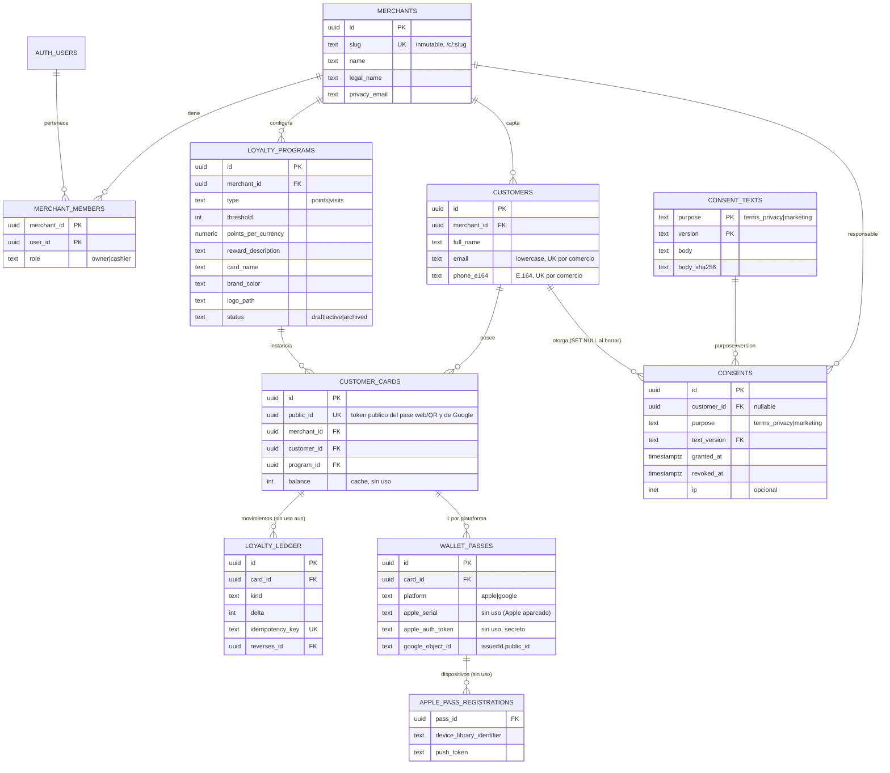

# Modelo de datos FidelityCard (MVP actual)

Estado: borrador. SQL asociado: `docs/drafts/0001_init.sql` (sintaxis validada con pglast, NO ejecutado contra una instancia real; ver "Pendiente de validar").
Base: PostgreSQL 15+ en Supabase (region UE). Alcance activo: alta/login de comercio, configuracion de tarjeta, alta publica de cliente, pase web (`/p/:token` con QR) y Google Wallet. **Apple Wallet aparcado**: sus tablas/columnas (`apple_pass_registrations`, `apple_*` en `wallet_passes` y `revoked_passes`) se conservan pero quedan **sin uso en el MVP**. El ledger de movimientos y el saldo existen pero **no se usan aun**.

## 1. ERD

Tablas auxiliares sin relaciones: `revoked_passes` (cola de invalidacion tras borrado) y `erasure_log` (registro de borrados de cliente o comercio, `scope`, sin PII).

## 2. Tablas, constraints e indices (resumen)

| Tabla | Puntos clave |
|---|---|
| `merchants` | `slug` unico, regex `^[a-z0-9][a-z0-9-]{1,38}[a-z0-9]$`, **inmutable por trigger** (esta grabado en piezas NFC). `legal_name`/`privacy_email` alimentan el texto RGPD de la landing. |
| `merchant_members` | Puente usuario-comercio con `role` (`owner`/`cashier`). Indice unico parcial: un usuario es owner de **un** comercio (MVP). Deja abierta la puerta a cajeros (S1) sin migrar. |
| `loyalty_programs` | La "tarjeta". CHECK: `points` exige `points_per_currency > 0`; `visits` exige NULL. Umbral 1..100000, color `#RRGGBB`. Indice unico parcial: **una sola activa** por comercio. `type` inmutable por trigger si ya hay tarjetas. Se archiva, no se borra. `visit_cooldown_minutes` (30) queda guardado para el antifraude futuro. |
| `consent_texts` | PK `(purpose, version)`: textos versionados **por finalidad** (`terms_privacy` obligatorio, `marketing` opcional), inmutables (hash SHA-256 por trigger). Seed de ambos como **placeholder pendiente de revision legal**. |
| `customers` | `email` solo se guarda normalizado (`lower(btrim)`, CHECK lo exige) y `phone_e164` con CHECK `^\+[1-9][0-9]{7,14}$`. `UNIQUE(merchant_id,email)` y `UNIQUE(merchant_id,phone_e164)` dan la idempotencia a nivel de BD. `UNIQUE(merchant_id,id)` es el destino de FKs compuestas. Indice `(merchant_id, created_at desc)` para la tabla del panel. |
| `customer_cards` | `public_id` (uuid aleatorio, 122 bits) es el **token publico del pase**: va en `/p/:token`, en el QR y en el `google_object_id`; `id` interno no se expone. `UNIQUE(customer_id, program_id)`. FKs **compuestas** `(merchant_id, customer_id)` y `(merchant_id, program_id)`: la BD impide cruzar tenants. `balance >= 0` es cache del ledger. |
| `consents` | Prueba RGPD, **una fila por finalidad**: `purpose` (`terms_privacy` | `marketing`), `text_version` (FK compuesta `(purpose, text_version)`), `granted_at`, `revoked_at` (retirar marketing sin perder la prueba), `ip`/`user_agent` opcionales, `source`. Indice unico parcial: un consentimiento vigente por cliente y finalidad. Marketing solo existe como fila si se marco la casilla. `customer_id` es `ON DELETE SET NULL`. |
| `loyalty_ledger` | Append-only (trigger bloquea UPDATE/DELETE/TRUNCATE). `kind` (`earn_visit`, `earn_points`, `redeem`, `adjust`, `reversal`) con CHECK de signo de `delta`; `UNIQUE(merchant_id, idempotency_key)`; una sola reversion por movimiento (indice unico parcial); `balance_after`; indices `(card_id, created_at desc)` y parcial de visitas para la ventana antifraude. `performed_by` **sin FK** a proposito (un `SET NULL` seria un UPDATE y el trigger lo bloquearia). |
| `wallet_passes` | Solo Google en el MVP (una fila por tarjeta y plataforma, `UNIQUE(card_id, platform)` = emision idempotente). Google: `google_object_id` unico = `<issuerId>.<public_id>`. El **pase web no necesita fila**: se resuelve por `customer_cards.public_id`. Columnas Apple (`apple_pass_type_id`, `apple_serial`, `apple_auth_token`) **sin uso**. CHECK obliga a que solo esten los campos de su plataforma. `last_changed_at` sirve de tag para `passesUpdatedSince`. |
| `apple_pass_registrations` | **Sin uso en el MVP (Apple aparcado).** Registro de dispositivos del web service de Apple: `device_library_identifier`, `push_token`; `UNIQUE(pass_id, device_library_identifier)`; indice por dispositivo. |
| `revoked_passes` | Cola sin PII de pases a invalidar tras un borrado (serial/token/push tokens/object id). Purgar procesadas a los 30 dias. |
| `erasure_log` | `merchant_id` + fecha + quien + `scope` (`customer`|`merchant`). Sin FK: sobrevive al comercio. |

Todos los FK tienen indice (los de `customer_cards`, `consents`, `ledger`, `wallet_passes` y `apple_pass_registrations` incluidos, directamente o via UNIQUE/PK).

## 3. Seguridad y RLS

**Modelo**: RLS activa en las 12 tablas. `anon` no tiene ningun GRANT sobre tablas (defensa en profundidad: sin grant ni siquiera llega a evaluar RLS). `authenticated` recibe solo lo imprescindible. No se usa `FORCE RLS` para que las funciones `SECURITY DEFINER` del owner funcionen.

**Helper** `app.my_merchant_ids(roles[])`: `SECURITY DEFINER`, `search_path=''`, vive en el esquema `app` (no expuesto por PostgREST). Devuelve `SETOF uuid` y se usa como `merchant_id in (select app.my_merchant_ids(...))`, de modo que Postgres lo evalua una vez (initPlan) y no por fila. Al ser definer evita la recursion con la RLS de `merchant_members`.

| Tabla | anon | authenticated (miembro del comercio) | service_role |
|---|---|---|---|
| `merchants` | nada | SELECT del suyo; UPDATE solo owner y solo columnas `name, legal_name, tax_id, privacy_email` (grant por columna; el slug no se toca). INSERT solo via `create_merchant`. | todo |
| `merchant_members` | nada | SELECT de sus filas (`user_id = auth.uid()`). Sin escritura. | todo |
| `loyalty_programs` | nada | SELECT miembros; INSERT/UPDATE owner con `WITH CHECK` (no se puede mover un programa a otro comercio). Sin DELETE. | todo |
| `consent_texts` | nada | SELECT | todo |
| `customers`, `customer_cards`, `consents`, `loyalty_ledger` | nada | SELECT solo owner de ese comercio. **Sin INSERT/UPDATE/DELETE** directos. | todo |
| `wallet_passes`, `apple_pass_registrations`, `revoked_passes`, `erasure_log` | nada | **nada** (RLS sin politicas + sin grants): los tokens de Apple jamas llegan a un navegador | todo |
| `storage` bucket `merchant-logos` | lectura publica del fichero (necesario para landing y pase) | escribir/borrar solo en la carpeta `<merchant_id>/` propia; PNG/JPEG/WebP, 1 MB | todo |

**Alta publica del cliente**
1. La landing llama a `get_public_merchant(slug)` (nombre de la RPC publica, se mantiene): devuelve nombre, textos legales, config visible de la tarjeta y los ultimos textos de **ambos** consentimientos (`consents.terms_privacy` y `consents.marketing`, cada uno `{version, body}`). Ningun id interno, ningun dato de clientes. La pagina del pase `/p/:token` usa `get_public_pass(token)` (tambien `anon`): datos visibles de la tarjeta + saldo, sin ids ni PII; token inexistente o cliente borrado => NULL.
2. El envio del formulario va a una **Edge Function** (service_role) que: verifica captcha (Turnstile) y rate-limit por IP/slug, normaliza el telefono a E.164 con libphonenumber **usando Espana (+34) como pais por defecto (logica solo en la Edge Function, no en SQL)**, captura IP/UA, y llama a `enroll_customer(...)` con `p_terms_accepted`/`p_terms_version` (obligatorios) y `p_marketing_opt_in`/`p_marketing_version` (casilla aparte, opcional). La funcion SQL solo tiene `EXECUTE` para `service_role`.
3. `enroll_customer` valida de nuevo todo (defensa en profundidad), serializa con `pg_advisory_xact_lock` sobre las claves email y telefono (orden fijo, sin deadlocks) y resuelve:
   - ni email ni telefono existen: crea cliente + consentimiento `terms_privacy` (+ `marketing` si se marco) + tarjeta (`created`);
   - ambos existen y son del **mismo** cliente: devuelve su tarjeta (`existing`), sin duplicar (reofrece el pase); si ahora marca marketing y no lo tenia vigente, se anade ese consentimiento;
   - coincide solo uno, o apuntan a clientes distintos: `already_registered` **sin datos** (ver trade-offs).

   **Respuesta de `enroll_customer`** (jsonb): `created` y `existing` devuelven `{status, card_id, card_public_id, balance, program_id, card:{merchant_name, card_name, type, threshold, reward_description, brand_color, logo_path}, marketing_opt_in}`; `card_public_id` es la credencial/token del pase (`/p/:token`, QR). `already_registered` devuelve solo `{status}`. Errores por excepcion: `terms_required`, `invalid_terms_version`, `invalid_marketing_version`, `invalid_name`, `invalid_email`, `invalid_phone`, `merchant_not_found`.
4. El pase web `/p/<card_public_id>` (QR = ese token) esta disponible siempre. Si el cliente pide Google Wallet, la Edge Function crea el objeto con id `<issuerId>.<card_public_id>` e inserta `wallet_passes` (`ON CONFLICT (card_id, platform)`). Apple Wallet queda aparcado.

**RGPD**
- Consentimiento **separado por finalidad**: `terms_privacy` (obligatorio; sin el no hay alta) y `marketing` (casilla propia, nunca premarcada ni condicion del alta). Cada uno con texto versionado e inmutable + fecha + IP/UA opcionales + comercio, en su propia fila. Check `granted` (no se guarda "no consentido": no marcar marketing = no hay fila). Ambos se borran/anonimizan igual en `erase_customer` (IP/UA a NULL, `customer_id` a NULL).
- Derecho al olvido: `erase_customer(customer_id)` (owner; mismo error si no existe o es de otro comercio). En una transaccion: encola pases en `revoked_passes`, anula IP/UA de sus consentimientos, borra cliente (cascada: tarjetas, ledger, pases, registros) con un flag transaccional que es la **unica** forma de saltarse el append-only, y anota `erasure_log`. Los consentimientos (de ambas finalidades) quedan sin `customer_id` (evidencia no identificable).
- Baja de comercio: `erase_merchant(merchant_id, confirm_slug)` (owner confirmando el slug, o `service_role`). Encola los pases, borra clientes -> tarjetas/ledger/pases y despues el comercio (programas, consentimientos, membresias por cascada) en una transaccion, y anota `erasure_log(scope='merchant')`. **No** toca `auth.users` ni los ficheros de storage: la Edge Function de baja borra `merchant-logos/<id>/` con la Storage API y, si procede, el usuario auth.
- Worker (Edge Function programada) procesa `revoked_passes`: Google marca el objeto como expirado (Apple, aparcado: `voided: true` + push). El pase web deja de resolverse solo (la tarjeta ya no existe).
- Alojamiento UE (region Supabase) y minimizacion: solo 3 datos + consentimiento.

## 4. Decisiones y trade-offs

1. **`text + CHECK` en vez de enums**: anadir valores (p.ej. nuevos `kind`) es un `ALTER ... CHECK`, sin las limitaciones de los enums.
2. **Normalizacion**: el email se normaliza en BD (barato, determinista). El telefono **no** se parsea en SQL (no hay libphonenumber): lo normaliza la Edge Function, que aplica **Espana (+34) por defecto** a numeros sin prefijo internacional; la BD solo garantiza formato E.164 y unicidad (sin `+` => `invalid_phone`). Sin extension `citext`.
3. **Email/telefono "O"**: UNIQUE separados cubren "mismo email o mismo telefono". Coste: un cliente que cambia de telefono no puede re-darse de alta solo; debe pedirlo al comercio (aceptable en MVP).
4. **Re-emision del pase exige email Y telefono coincidentes**: si bastara uno, cualquiera que conozca un email obtendria el `card_public_id` (credencial de la tarjeta). Trade-off: `already_registered` revela que esa persona ya existe en ese comercio (enumeracion), mitigado con captcha y rate limit en la Edge Function. Alternativa futura: enlace magico por email.
5. **RPC solo para service_role (no anon)**: permite rate limiting, captcha, captura fiable de IP y firma de pases en el mismo punto. Coste: depende de la Edge Function; el SQL queda igualmente seguro si alguien invoca el RPC directamente (no tiene EXECUTE).
6. **Secretos de pase**: `apple_auth_token` se guarda en claro porque debe incluirse en `pass.json` y compararse; esta protegido por no tener politicas ni grants. Alternativa: derivarlo con HMAC(serial, secreto del servidor) y no guardarlo.
7. **Borrado real vs. prueba de consentimiento**: se prioriza el borrado (PRD H8); lo que sobrevive no identifica a nadie. Si Legal exige conservar prueba identificable (art. 17.3.e) habria que guardar un hash con sal; esta decision necesita revision legal.
8. **Ledger + saldo cache**: el ledger sera la fuente de verdad; `customer_cards.balance` se actualizara en la futura RPC `apply_movement` (misma transaccion, `SELECT ... FOR UPDATE` de la tarjeta). Activarlo es solo anadir funciones: sin ALTER ni migracion destructiva. Para esa fase: `UNIQUE` de idempotencia ya existe y `visit_cooldown_minutes` ya esta modelado.
9. **Tenant integrity en el esquema, no solo en RLS**: las FKs compuestas `(merchant_id, x_id)` hacen imposible, incluso con service_role, enlazar entidades de comercios distintos.
10. **`merchant_members` desde el dia 1** aunque el MVP es "1 comercio = 1 dueno": cuesta una tabla y evita migrar todas las policies al llegar los cajeros.
11. **Borrado de un comercio completo** cubierto por `erase_merchant` (ver RGPD). Borrado explicito en orden porque `cards_program_fk` es RESTRICT y el ledger solo admite DELETE bajo el flag transaccional. Tampoco se borra el comercio al borrar el `auth.users` (solo la membresia). Los binarios de storage requieren la Storage API.
12. **Retencion de IP**: se guarda opcional; se recomienda un job que ponga a NULL `consents.ip` pasados N meses (decision del DPO).
13. **Pase web y Google sin columnas nuevas**: el token publico es `customer_cards.public_id` (ya unico, aleatorio) y el object id de Google se deriva de el y se guarda en `wallet_passes.google_object_id` (unico). `/p/:token` es una capacidad bearer: aceptable por 122 bits de entropia; sin rotacion en MVP (si se filtra, borrar y re-emitir).
14. **Marketing separado**: dos filas en `consents` en vez de un booleano en `customers`, para conservar version de texto, fecha e IP de cada consentimiento y poder retirarlo (`revoked_at`) sin tocar el basico.
15. **Rendimiento**: volumen previsto pequeno por tenant; indices pensados para (a) panel de clientes paginado, (b) lookup de idempotencia, (c) historial por tarjeta, (d) ventana antifraude. Antes de produccion, `EXPLAIN ANALYZE` de las 4 consultas con datos sinteticos (p. ej. 100k clientes).

## 5. Casos de prueba de seguridad RLS (deben pasar)

Preparacion: comercios A y B (owners UA y UB), un cliente y una tarjeta en cada uno, un usuario autenticado UC sin comercio. Roles a probar: `anon`, `authenticated` (UA, UB, UC), `service_role`.

**Aislamiento entre comercios**
1. UA `select * from customers` solo devuelve clientes de A (0 de B).
2. UA `select` por id de un cliente de B devuelve 0 filas; igual para `customer_cards`, `consents`, `loyalty_ledger`, `loyalty_programs`, `merchants`.
3. UA `update merchants set name=... where id = B` afecta 0 filas.
4. UA `insert into loyalty_programs (merchant_id=B, ...)` falla por RLS.
5. UA `update loyalty_programs set merchant_id = B` falla (`WITH CHECK`).
6. UA `erase_customer(<cliente de B>)` falla con `forbidden_or_not_found`, mismo error que con un uuid inexistente.
7. UA no puede subir/borrar ficheros en `merchant-logos/<B>/...`; si en `<A>/...`.
8. UC (sin comercio) ve 0 filas en todas las tablas; `create_merchant` funciona una vez y una segunda llamada falla (`merchant_already_exists`).

**Anonimo**
9. `anon` `select` sobre cualquier tabla de `public` falla (permission denied), incluida `consent_texts`.
10. `anon` `insert/update/delete` en cualquier tabla falla.
11. `anon` no puede ejecutar `enroll_customer`, `erase_customer`, `erase_merchant` ni `create_merchant` (permission denied).
12. `anon` ejecuta `get_public_merchant('slug-valido')` y la respuesta no contiene ids, emails, telefonos ni datos de clientes; con un slug inexistente o de comercio sin tarjeta activa devuelve NULL/vacio. La respuesta incluye `consents.terms_privacy` y `consents.marketing`.
12b. `anon` ejecuta `get_public_pass(<public_id>)`: devuelve datos de tarjeta sin ids internos ni PII; con uuid inexistente devuelve NULL.
13. `anon` no puede listar `storage.objects`; si leer un logo por URL publica.

**Secretos de pase**
14. UA/UB `select` en `wallet_passes`, `apple_pass_registrations`, `revoked_passes`, `erasure_log`: permission denied (o 0 filas).

**Escritura restringida**
15. UA `insert/update/delete` directo en `customers`, `customer_cards`, `consents`, `loyalty_ledger`: denegado.
16. UA `update merchants set slug='x'` falla (sin grant de columna y trigger de inmutabilidad), incluso como service_role.
17. UA `delete from loyalty_programs` denegado (no hay policy/grant).
18. Un `cashier` (cuando exista) no ve `customers` y no puede editar `loyalty_programs`.

**Integridad e idempotencia (service_role)**
19. `enroll_customer` dos veces con los mismos email+telefono: 1 cliente, 1 tarjeta, 1 consentimiento `terms_privacy`; segunda respuesta `existing` con el mismo `card_public_id`.
20. Mismo email con otro telefono: `already_registered`, sin `card_public_id` ni ids.
21. Email con mayusculas/espacios (`" Ana@X.com "`) se trata igual que `ana@x.com`. Telefono sin `+` o invalido: `invalid_phone`.
22. `p_terms_accepted=false` (`terms_required`), `terms_version` inexistente, o `p_marketing_opt_in=true` con `marketing_version` inexistente: error y **0 filas** creadas (transaccion completa). Un `terms_version` de otra finalidad tambien falla.
23. 20 llamadas concurrentes con el mismo email+telefono: 1 cliente, sin errores de unique ni deadlocks.
24. Mismo email en comercios A y B: dos clientes independientes.
25. Insertar una tarjeta con `merchant_id`=A, `customer_id` de B falla por FK compuesta.
26. No se puede cambiar `loyalty_programs.type` con tarjetas creadas; dos programas `active` en un comercio fallan.
27. `update`/`delete`/`truncate` sobre `loyalty_ledger` falla (incluso con service_role); `delete` solo funciona dentro de `erase_customer`.
28. Dos `reversal` del mismo movimiento fallan; dos movimientos con la misma `idempotency_key` fallan.

**Derecho al olvido**
29. Tras `erase_customer(id)`: 0 filas del cliente en `customers`, `customer_cards`, `loyalty_ledger`, `wallet_passes`, `apple_pass_registrations`; `consents` conserva la fila con `customer_id NULL`, `ip NULL`, `user_agent NULL`; existe fila en `revoked_passes` y en `erasure_log`.
30. Tras el borrado, el mismo email/telefono puede darse de alta de nuevo (nuevo cliente, nuevo `public_id`).

**Consentimientos separados**
31. Alta sin marcar marketing: 1 fila `consents` (`terms_privacy`), 0 de `marketing`; respuesta `marketing_opt_in=false`. Marcando marketing: 2 filas con sus versiones y `marketing_opt_in=true`.
32. Un `existing` que ahora marca marketing anade 1 fila `marketing`; repetirlo no duplica (indice parcial). Tras `erase_customer`, ambas filas quedan con `customer_id`, `ip` y `user_agent` NULL.

**Pase web / Google**
33. `get_public_pass(card_public_id)` resuelve antes de `erase_customer` y devuelve NULL despues. `wallet_passes` rechaza dos filas `google` con el mismo `google_object_id`.

**Borrado de comercio (`erase_merchant`)**
34. Como owner de A con `confirm_slug` correcto: 0 filas de A en `merchants`, `merchant_members`, `loyalty_programs`, `customers`, `customer_cards`, `consents`, `loyalty_ledger`, `wallet_passes`; filas en `revoked_passes` por cada pase; 1 fila en `erasure_log` (`scope='merchant'`); datos de B intactos.
35. Falla con `forbidden_or_not_found` (mismo error que uuid inexistente) para: UB sobre A, UC sin comercio, `anon`, `cashier`, y owner con `confirm_slug` incorrecto; en todos 0 filas borradas. `service_role` puede borrar cualquier comercio. Con ledger con movimientos y varias tarjetas el borrado no falla por el append-only ni por `cards_program_fk`.

## 6. Pendiente de validar

- El SQL solo se ha validado **sintacticamente** (pglast 8.7: parseo del script completo y de los 9 cuerpos plpgsql). **No se ha ejecutado** (no hay Postgres/Docker en el entorno): errores de semantica/runtime siguen posibles. Antes de moverlo a `supabase/migrations`: ejecutarlo en un proyecto Supabase local (`supabase start`), automatizar la lista de la seccion 5 con pgTAP y revisar el `EXPLAIN` de las consultas clave.
- Revision legal del texto de consentimiento y de la politica de retencion (IP, consentimientos tras el borrado).
- Revision legal tambien del texto de marketing (`marketing`, placeholder).
- Confirmar con Arquitectura que la emision de pases y el worker de `revoked_passes` van en Edge Functions con service_role.
