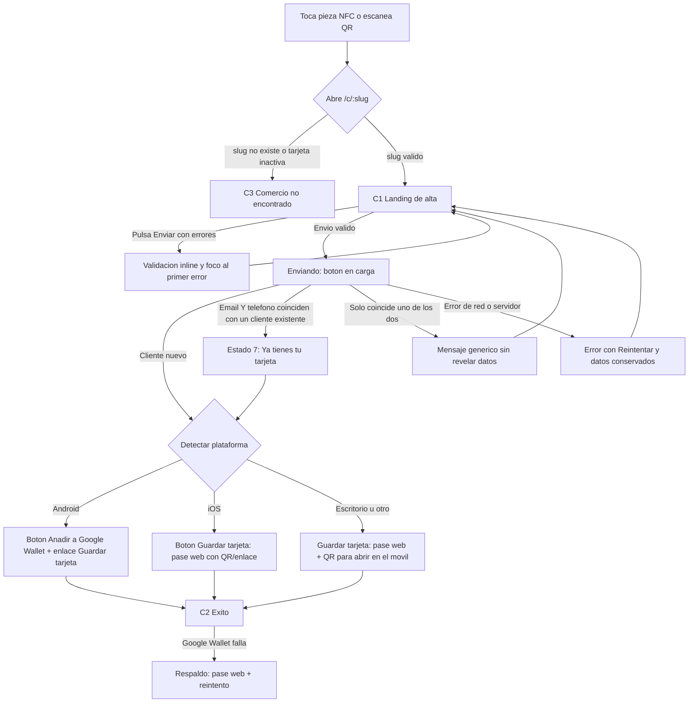
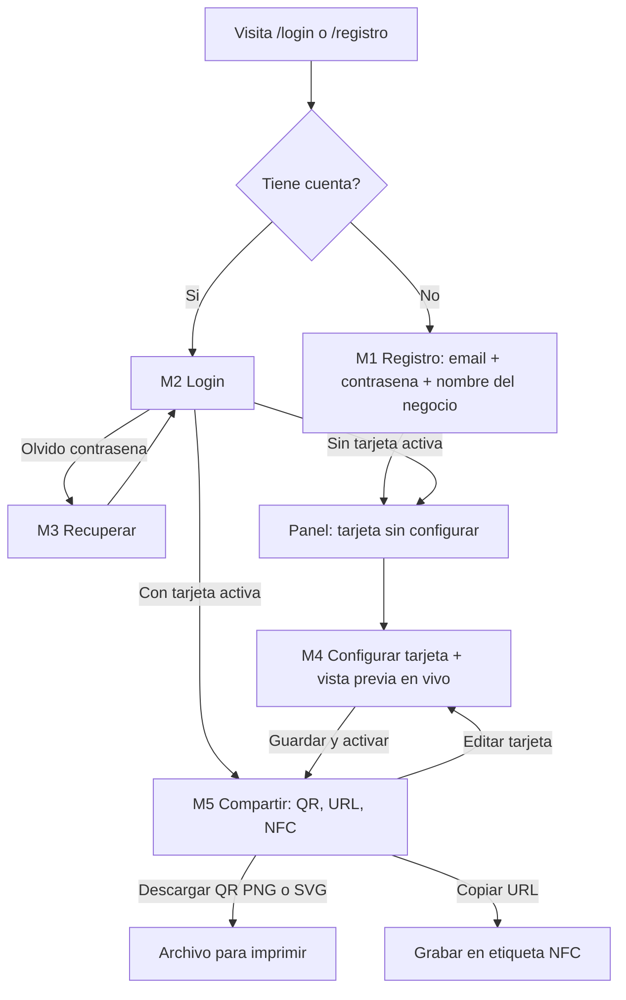

# UX/UI FidelityCard (MVP actual)

**Autor**: ArchitectUX | **Fecha**: 2026-10-20 | **Versión**: 0.2 (decisiones del dueño: reoferta de pase solo con email Y teléfono, Apple Wallet aparcado, marketing separado, +34 por defecto)
**Stack front**: React JS + Tailwind. Mobile-first estricto en la landing del cliente.

## 0. Alcance de este documento

Prevalece la decisión del dueño sobre el PRD. Solo se diseña:

1. Alta/login de comercio y panel mínimo (configurar tarjeta, obtener URL/QR/instrucciones NFC).
2. Cliente final: entra por NFC o QR a `/c/:slug`, rellena Nombre completo, Email, Teléfono (país por defecto +34), el consentimiento básico obligatorio y, opcionalmente, una casilla de marketing separada, y obtiene su pase.

Decisiones del dueño vigentes en esta versión:
- **Los clientes no tienen cuenta ni login.** Nunca se les pide iniciar sesión; el único "login" del producto es el del comercio.
- **Apple Wallet aparcado en el MVP.** Solo se ofrece Google Wallet (Android) y "Guardar tarjeta" como pase web con QR/enlace (iOS y escritorio). El botón de Apple queda descrito como futuro tras un flag (`WALLET_APPLE_ENABLED`, sección 2.1 estado 4).
- **Reoferta del pase solo con email Y teléfono coincidentes** (sección 2.1 estado 7).
- **Marketing en casilla separada y no premarcada**, además del consentimiento básico obligatorio.

**Fuera de alcance (no diseñado)**: sumar visitas/puntos, canje, vista de caja, lista de clientes y KPIs. El panel deja un hueco previsto en la navegación (sección 2.4) pero no se diseña su contenido.

Principio rector: la landing se abre en una cola de caja con una mano. Cada elemento que no ayuda a completar el alta sobra.

---

## 1. Mapa de pantallas y flujos

### 1.1 Inventario de pantallas

| ID | Pantalla | Ruta | Usuario |
|---|---|---|---|
| C1 | Landing de alta (con todos sus estados) | `/c/:slug` | Cliente |
| C2 | Éxito + botón de wallet | `/c/:slug` (mismo URL, estado) | Cliente |
| C3 | Comercio no encontrado / inactivo | `/c/:slug` (estado) | Cliente |
| C4 | Política de privacidad (hoja inferior o página) | `/c/:slug/privacidad` | Cliente |
| M1 | Registro de comercio | `/registro` | Comercio |
| M2 | Login | `/login` | Comercio |
| M3 | Recuperar contraseña | `/recuperar` | Comercio |
| M4 | Panel: configurar tarjeta (+ vista previa) | `/panel/tarjeta` | Comercio |
| M5 | Panel: compartir (QR, URL, NFC) | `/panel/compartir` | Comercio |

### 1.2 Flujo del cliente final



### 1.3 Flujo del comercio



Notas de flujo:
- El registro pide solo 3 campos; el color, el logo y el resto se completan en M4 para que el dueño llegue al panel en menos de 1 minuto.
- El comercio no puede activar la tarjeta sin tipo, umbral y recompensa. Nombre, color y logo tienen valores por defecto.
- Tras activar se redirige a M5 con un aviso de éxito y el QR ya visible.

---

## 2. Wireframes

Convenciones: `[ ]` campo, `( )` botón secundario, `[[ ]]` botón primario, `{{ }}` zona dinámica, `---` separador. Ancho base 360 px.

### 2.1 Cliente: Landing de alta `/c/:slug`

#### Principios de la pantalla
- Todo el flujo cabe en una sola pantalla en 360x640 sin scroll hasta el botón en estado vacío (teclado cerrado). Con teclado abierto, el scroll mantiene visible el campo activo (`scroll-margin`).
- Sin cabecera de navegación, sin menú, sin selector de tema (sigue el tema del sistema).
- Tres campos, dos casillas (consentimiento básico obligatorio + marketing opcional, separadas), un botón.
- Primera carga: HTML mínimo, sin fuentes web externas (fuente del sistema), logo con `width/height` fijos para evitar saltos de maquetación.
- El logo y el color del comercio dan confianza ("estoy en la tienda correcta").

#### Estado 1: vacío (carga inicial)

```
┌────────────────────────────────┐ 360 px
│ {{barra de color del comercio}}│ 6 px de alto
│                                │
│        ( logo 56x56 )          │
│      Cafetería La Plaza        │  H1 22/28 semibold
│                                │
│  Consigue tu tarjeta de        │  texto 16/24
│  fidelidad en tu móvil         │
│  ┌──────────────────────────┐  │
│  │ ☕ Cada 8 cafés, 1 gratis │  │  chip recompensa
│  └──────────────────────────┘  │
│                                │
│  Nombre completo               │  label 14 medium
│  [ María García López        ] │  alto 48, autocomplete=name
│                                │
│  Email                         │
│  [ tu@correo.com             ] │  type=email inputmode=email
│                                │
│  Teléfono móvil                │
│  [🇪🇸 +34 ▾][ 612 34 56 78   ] │  type=tel inputmode=tel, país por defecto +34
│                                │
│  [ ] Acepto que Cafetería La   │  checkbox 24x24, NO premarcada, OBLIGATORIA
│      Plaza use mis datos para  │
│      gestionar mi tarjeta de   │
│      fidelidad. Más info       │
│  [ ] Quiero recibir ofertas y  │  checkbox 24x24, NO premarcada, OPCIONAL
│      novedades de Cafetería La │  (separada de la anterior)
│      Plaza (opcional)          │
│                                │
│  [[ Obtener mi tarjeta ]]      │  alto 52, ancho completo
│                                │
│  Tratamiento de datos · Quién  │  texto 12, enlace a C4
│  es el responsable             │
└────────────────────────────────┘
```

- El botón principal es siempre pulsable (no se deshabilita en vacío); al pulsarlo con errores se valida y se enfoca el primer error. Deshabilitar por defecto sin explicar por qué es un fallo de accesibilidad y de usabilidad.
- Atributos `autocomplete` obligatorios: `name`, `email`, `tel` para que el móvil rellene con un toque.
- El chip de recompensa sale de la configuración del comercio (tipo + umbral + descripción). Ejemplos: "Cada 8 visitas, 1 café gratis" o "A 100 puntos, un menú gratis".
- Sin placeholders como único etiquetado: las etiquetas son visibles siempre. Los placeholders son ejemplos en gris con contraste suficiente.

#### Estado 2: validación (errores inline)

```
│  Nombre completo               │
│  [ María                     ] │  borde 2px rojo en error
│  ⚠ Escribe tu nombre y apellido│  icono + texto, rojo oscuro
│                                │
│  Email                         │
│  [ maria@correo              ] │
│  ⚠ Revisa el email: falta algo │
│    como "@correo.com"          │
│                                │
│  Teléfono móvil                │
│  [ 61234                     ] │
│  ⚠ Escribe un móvil de 9 cifras│
│                                │
│  [ ] Acepto…                   │
│  ⚠ Necesitamos tu aceptación   │
│    para crear la tarjeta       │
```

Reglas de validación:
- Se valida al salir del campo (`onBlur`) solo si el usuario ya escribió algo, y de nuevo al enviar. No se muestran errores mientras se escribe por primera vez.
- Al corregir, el error desaparece al instante (`onChange`).
- Al enviar con errores: foco al primer campo inválido y un resumen anunciado con `aria-live="polite"` ("Hay 3 campos por revisar").
- El error se asocia al campo con `aria-describedby` y `aria-invalid="true"`. Nunca se indica solo con color.
- Nombre: mínimo 2 caracteres y al menos 2 palabras (no se bloquean nombres reales atípicos: si hay 1 palabra, error suave con texto "Escribe nombre y apellido"; criterio final a decidir, ver sección 8).
- Teléfono: el selector de país viene preseleccionado en **+34 (España)**; el usuario escribe solo las 9 cifras. Se admiten espacios, guiones y prefijo `+34`/`0034` pegado; se normaliza a E.164 antes de enviar (`libphonenumber-js`, país por defecto ES). Si el usuario cambia el país o pega un prefijo no español y es válido internacionalmente, se acepta.
- Casilla de marketing: nunca se valida ni bloquea el envío; su valor (marcada o no) se envía como consentimiento independiente. Desmarcada por defecto y tras un error de envío se conserva el estado que el usuario eligió.
- Email: validación de formato simple; sugerencia de typos comunes ("¿Quisiste decir gmail.com?") como ayuda, sin bloquear.

#### Estado 3: enviando

```
│  [[ ◌ Creando tu tarjeta… ]]   │  spinner + texto, aria-busy
```

- Campos en `readonly` (no `disabled`, para conservar contraste y foco), botón no reenviable (evita doble envío; el servidor también debe ser idempotente por email+comercio).
- Si tarda más de 4 s, el texto cambia a "Seguimos con tu tarjeta, un momento…".
- Tiempo de espera máximo de 15 s, tras el cual pasa al estado de error con "Reintentar".

#### Estado 4: éxito con botones de wallet (C2)

La pantalla reemplaza el formulario en la misma URL (sin recarga), con transición de 150 ms (omitida con `prefers-reduced-motion`).

En el MVP **Apple Wallet está aparcado**: no se muestra ningún botón de Apple. Se ofrece Google Wallet en Android y "Guardar tarjeta" (pase web con QR/enlace) en iOS y escritorio.

**4a. iPhone (iOS)**: pase web como opción principal

```
┌────────────────────────────────┐
│ {{barra de color}}             │
│                                │
│            ✓ (48)              │  icono check, no depende solo del color
│   ¡Listo, María!               │  H1
│   Tu tarjeta de Cafetería La   │
│   Plaza está creada.           │
│                                │
│  ┌──────────────────────────┐  │
│  │  {{mini tarjeta visual}} │  │  la misma vista previa que el panel
│  │  0 / 8 visitas           │  │
│  └──────────────────────────┘  │
│                                │
│  [[  Guardar tarjeta  ]]       │  pase web (/p/:token), alto >= 48
│                                │
│  Guarda el enlace o hazle una  │  ayuda: añadir a pantalla de inicio /
│  captura al QR para tenerla a  │  favoritos; el QR del pase es lo que
│  mano en caja.                 │  se enseña en el comercio
│  ( Usar Google Wallet )        │  enlace secundario pequeño
└────────────────────────────────┘
```

**4b. Android**: botón oficial "Añadir a Google Wallet" como principal; debajo, enlace secundario "Guardar tarjeta en el navegador" (pase web) como respaldo.

**4c. Escritorio u otros navegadores** (dueño probando la URL, o iPad/otro):

```
│  Añade tu tarjeta desde el móvil
│  ┌────────┐
│  │  QR    │  Escanéalo con tu móvil
│  └────────┘  (abre el pase web de tu tarjeta)
│  [[ Guardar tarjeta ]]            pase web con QR/enlace
│  [[ Añadir a Google Wallet ]]     solo si es viable en escritorio; si no, se omite
```

**Futuro, tras flag (no en el MVP)**: botón oficial "Añadir a Apple Wallet" en iOS y en escritorio, detrás de un flag de configuración (`WALLET_APPLE_ENABLED`, apagado por defecto). Cuando se active: en iOS pasa a ser el botón principal y "Guardar tarjeta" queda como enlace secundario; en escritorio se muestra junto a los demás. Hasta entonces ningún texto, botón ni telemetría de Apple es visible al cliente.

Reglas de detección de plataforma (decisión UX; implementación a cargo del desarrollador):
- Android: `/Android/i`. Se muestra Google Wallet como principal y "Guardar tarjeta" (pase web) como secundario.
- iOS: `navigator.userAgent` contiene iPhone/iPad/iPod, o `navigator.platform === 'MacIntel'` con `maxTouchPoints > 1` (iPadOS se presenta como Mac). Se muestra "Guardar tarjeta" (pase web) como principal y un enlace pequeño "Usar Google Wallet" (para quien tenga la app en el iPhone).
- Otros (escritorio, desconocido): se muestra "Guardar tarjeta" con QR para abrirla en el móvil, y Google Wallet si procede.
- La detección falla en silencio hacia "otros": en la duda se muestran ambas opciones. Nunca se oculta la opción correcta por error de detección: bajo el botón principal siempre hay un enlace pequeño a la alternativa en móvil.
- El botón de Google debe usar el activo de marca oficial (guías de marca de Google); se respetan tamaño mínimo y zona de respeto. No se rediseña. El botón "Guardar tarjeta" es propio (componente Button primario). Cuando exista el botón de Apple, aplicará la misma regla.

Comportamiento del botón de wallet:
- Tras pulsar, el botón pasa a estado de carga ("Abriendo Wallet…") hasta que el sistema abre la hoja nativa; si en 8 s no hay cambio de contexto, se muestra el respaldo.
- Una vez añadida a Google Wallet (si la plataforma lo informa), se muestra "Tarjeta guardada. Ya puedes cerrar esta página". Si no hay confirmación posible, el texto permanente es "Cuando la veas en Wallet, ya puedes cerrar esta página". Con el pase web ("Guardar tarjeta") se abre `/p/:token` y el texto es "Tu tarjeta está lista. Guarda este enlace para tenerla siempre a mano."
- Los datos del cliente no aparecen en la URL ni se guardan en `localStorage` en claro. Solo se guarda un indicador no personal de "ya registrado en este comercio" para reofrecer el botón si recarga. El pase web se identifica por un token opaco de la URL, no por una cuenta: el cliente no inicia sesión nunca.

#### Estado 5: error

Tres tipos, tres tratamientos:

| Tipo | Cuándo | Presentación |
|---|---|---|
| Red/servidor | Sin conexión, 5xx, timeout | Banner sobre el botón, los datos del formulario se conservan |
| Wallet | Falla la generación del pase | Pantalla de éxito pero con respaldo prominente (enlace al pase web) |
| Límite | Demasiados intentos (429) | Mensaje con tiempo de espera, botón deshabilitado temporalmente con cuenta atrás |

```
│  ┌──────────────────────────┐  │
│  │ ⚠ No hemos podido crear  │  │  role="alert"
│  │ tu tarjeta. Revisa tu    │  │
│  │ conexión e inténtalo de  │  │
│  │ nuevo. No has perdido    │  │
│  │ nada de lo escrito.      │  │
│  └──────────────────────────┘  │
│  [[ Reintentar ]]              │
```

Sin conexión: se detecta `navigator.onLine === false` y se avisa antes de enviar ("Sin conexión. Conéctate para continuar"). Los datos no se encolan para envío diferido en el MVP.

#### Estado 6: comercio no encontrado (C3)

```
┌────────────────────────────────┐
│                                │
│          ( icono lupa )        │
│   No encontramos esta tarjeta  │  H1
│                                │
│   El enlace puede estar        │
│   desactivado o mal escrito.   │
│   Pregunta en el mostrador     │
│   por un nuevo código.         │
│                                │
│   Nada que hacer por aquí:     │  sin formulario, sin enlaces a otros comercios
└────────────────────────────────┘
```

- Mismo texto para "slug inexistente" y "tarjeta no activa" (no se filtra qué comercios existen).
- Estado de carga previo a esto: esqueleto (logo gris, 3 barras) máximo 1 s; si la consulta del comercio supera 3 s, se muestra error de red con Reintentar, no "no encontrado".

#### Estado 7: cliente ya registrado

**Regla (decisión del dueño)**: el pase de un cliente ya registrado se reofrece **únicamente si coinciden email Y teléfono** con los de un cliente existente en ese comercio. Como el formulario ya pide ambos, no hay paso extra. Los clientes no tienen cuenta ni login: la coincidencia de los dos datos es la única "prueba".

| Resultado del servidor | Qué ve el cliente |
|---|---|
| Email Y teléfono coinciden (`existing`) | Pantalla "Ya tienes tu tarjeta" con el mismo bloque de pase de C2 |
| Solo coincide uno de los dos (`already_registered`) | Mensaje genérico (abajo); no se ofrece pase y no se revela cuál dato coincide ni que la persona existe |
| Ninguno coincide | Alta nueva (estado 4) |

Pantalla de coincidencia total:

```
│  ✓ Ya tienes tu tarjeta        │  H1
│  Ya estabas registrado/a en    │
│  Cafetería La Plaza. No hace   │
│  falta crear otra.             │
│                                │
│  [[ Añadir a Google Wallet ]]  │  mismo bloque de pase de C2 según
│  [[ Guardar tarjeta ]]         │  plataforma (sección 4: Android / iOS / escritorio)
│                                │
│  ¿Esos no son tus datos?       │
│  Escríbenos a …                │  enlace de contacto del comercio (si existe)
```

Pantalla de coincidencia parcial (el formulario se mantiene con los datos escritos, en el estado de error de la sección Estado 5, `role="alert"`):

```
│  ┌──────────────────────────┐  │
│  │ ⚠ No hemos podido        │  │
│  │ completar el alta. Si ya │  │
│  │ tenías tarjeta, usa los  │  │
│  │ mismos datos o consulta  │  │
│  │ con el comercio.         │  │
│  └──────────────────────────┘  │
│  [[ Obtener mi tarjeta ]]      │
```

Decisiones de privacidad:
- No se muestra ningún dato del cliente existente (ni nombre, ni email, ni saldo) en ningún caso.
- El mensaje de coincidencia parcial es genérico y no distingue "email ya usado", "teléfono ya usado" ni "error": evita que un tercero que conozca un email obtenga el pase o confirme que alguien es cliente. Es un mensaje distinto del de fallo de red (Estado 5), pero no revela la causa.
- Un cliente que cambió de teléfono o de email no puede re-darse de alta solo: debe consultar con el comercio (aceptado para el MVP, alineado con DATA-MODEL.md).
- **Futuro** (cuando haya dominio propio con envío de email fiable): enlace por email para reofrecer el pase sin pedir coincidencia de ambos datos. No se diseña ahora.

#### Resumen de estados de la landing

| Estado | Disparador | Elemento clave | Anuncio a lector de pantalla |
|---|---|---|---|
| Cargando comercio | Entrada a la URL | Esqueleto | `aria-busy` en contenedor |
| Vacío | Carga correcta | Formulario | "Alta en {{comercio}}" (H1) |
| Validación | Blur o envío con errores | Errores inline | Resumen en `aria-live` |
| Enviando | Envío válido | Botón con spinner | "Creando tu tarjeta" |
| Éxito | 201 | Botón de wallet | Foco al H1 de éxito |
| Ya registrado | 200 existente (email Y teléfono coinciden) | Botón de pase | Foco al H1 |
| Alta no completada | Coincide solo email o solo teléfono | Banner genérico `role="alert"` | Se anuncia al aparecer |
| Error | Red/5xx/429 | Banner `role="alert"` | Se anuncia al aparecer |
| No encontrado | 404 | Mensaje | Foco al H1 |

### 2.2 Cliente: política de privacidad (C4)

Se abre como hoja inferior (bottom sheet) sobre la landing para no perder lo escrito; incluye también URL directa `/c/:slug/privacidad`.

```
┌────────────────────────────────┐
│ ───  (asa)                     │
│ Cómo tratamos tus datos     (X)│
│                                │
│ Responsable                    │
│ {{Razón social del comercio}}  │
│ NIF {{…}} · {{dirección}}      │
│ Encargado: {{plataforma}}      │
│                                │
│ Para qué usamos tus datos      │
│ Para gestionar tu tarjeta de   │
│ fidelidad…                     │
│                                │
│ Tus derechos y cómo darte de   │
│ baja                           │
│ …                              │
│                                │
│ [[ Entendido ]]                │
└────────────────────────────────┘
```

Los datos del responsable salen del perfil del comercio; el registro (M1) pedirá razón social y NIF en el paso de configuración para poder mostrar esto (ver sección 8).

### 2.3 Comercio: registro y login (M1, M2, M3)

Layout móvil: una columna centrada. En escritorio (>= 768 px): tarjeta de 420 px centrada sobre fondo neutro. Esta zona es responsive pero el uso principal esperado es escritorio o tableta.

**M1 Registro**

```
┌────────────────────────────────────────┐
│            FidelityCard                │  logotipo texto
│                                        │
│   Crea tu tarjeta de fidelidad         │  H1
│   en unos minutos                      │
│                                        │
│   Nombre del negocio                   │
│   [ Cafetería La Plaza               ] │
│                                        │
│   Email                                │
│   [ tu@negocio.com                   ] │
│                                        │
│   Contraseña                           │
│   [ ••••••••••••               ] (👁)  │  botón mostrar/ocultar, con etiqueta accesible
│   Mínimo 8 caracteres                  │  ayuda visible desde el inicio
│                                        │
│   [[ Crear cuenta ]]                   │
│                                        │
│   ¿Ya tienes cuenta? Entrar            │
│   Al crear la cuenta aceptas los       │
│   Términos y la Política de privacidad │
└────────────────────────────────────────┘
```

- Contraseña: mínimo 8 caracteres, sin reglas de composición forzadas; indicador de longitud en texto. Mostrar/ocultar con `aria-pressed`.
- Email ya registrado: error genérico "No hemos podido crear la cuenta con ese email. Si ya tienes una, entra con ella." (no revela existencia; enlace a login).
- Tras registro: si la autenticación exige confirmar email, pantalla intermedia "Revisa tu correo" con botón "Reenviar" (enfriamiento 60 s). Decisión pendiente con Arquitectura (sección 8).

**M2 Login**

```
│   Entra en tu panel                    │
│   Email                                │
│   [                                  ] │
│   Contraseña                           │
│   [                              ] (👁)│
│   ¿Olvidaste tu contraseña?            │
│   [[ Entrar ]]                         │
│   ¿Aún no tienes cuenta? Crear cuenta  │
```

- Error de credenciales: "Email o contraseña incorrectos." (un único mensaje; no distingue cuál falla).
- Tras 5 fallos: "Demasiados intentos. Espera un minuto o recupera tu contraseña."

**M3 Recuperar**: un campo email, mensaje de confirmación idéntico exista o no la cuenta ("Si existe una cuenta con ese email, te hemos enviado un enlace").

### 2.4 Comercio: estructura del panel

```
Escritorio (>= 1024 px)                    Móvil (< 768 px)
┌─────────┬─────────────────────────┐      ┌───────────────────────┐
│ Logo    │  Título de página       │      │ ☰  Cafetería La Plaza │
│         │  ───────────────────    │      ├───────────────────────┤
│ Tarjeta │  {{contenido}}          │      │ {{contenido}}         │
│ Compartir                         │      │                       │
│ (Clientes) deshabilitado: "Pronto"│      ├───────────────────────┤
│         │                         │      │ Tarjeta | Compartir   │ barra inferior
│ Salir   │                         │      └───────────────────────┘
└─────────┴─────────────────────────┘
```

- Solo dos secciones activas: **Tarjeta** (M4) y **Compartir** (M5). "Clientes" aparece inactivo con etiqueta "Próximamente" para anticipar el producto sin implementarlo, o se omite si el dueño prefiere (decisión de producto).
- Estado vacío de panel (sin tarjeta): banner con dos pasos numerados: "1. Configura tu tarjeta  2. Comparte el QR o la pieza NFC". El paso 2 está bloqueado hasta completar el 1.

### 2.5 Comercio: configurar tarjeta con vista previa en vivo (M4)

Escritorio: formulario a la izquierda (60 %), vista previa fija (sticky) a la derecha (40 %). Móvil: vista previa colapsable arriba del formulario ("Ver vista previa") más un botón flotante que la abre en hoja inferior.

```
┌────────────────────────────────────────────────────────────────────┐
│ Tu tarjeta                                          Estado: Borrador│
├──────────────────────────────────────┬─────────────────────────────┤
│ 1. Datos del negocio                 │   VISTA PREVIA              │
│ Nombre en la tarjeta                 │  ┌───────────────────────┐  │
│ [ Cafetería La Plaza             ]   │  │ ( logo ) La Plaza     │  │
│ Logo                                 │  │                       │  │
│ ( Subir logo )  PNG/JPG/SVG ≤ 1 MB   │  │ Cada 8 visitas        │  │
│ Color de la tarjeta                  │  │ 1 café gratis         │  │
│ ● ● ● ● ● ●  + [ #4F46E5 ]           │  │                       │  │
│                                      │  │ ○ ○ ○ ○ ○ ○ ○ ○       │  │
│ 2. Tipo de tarjeta                   │  │ 0 / 8 visitas         │  │
│ (●) Por visitas  ( ) Por puntos      │  │ ▮▮▮▮▮▯▯▯ (código)    │  │
│                                      │  └───────────────────────┘  │
│ 3. Cuándo se gana la recompensa      │  [ iOS ] [ Android ] [ Web ]│  selector de formato
│ Número de visitas                    │                             │
│ [ 8 ] visitas   (− / +)              │  Así verá tu cliente la     │
│                                      │  tarjeta (orientativo; el   │
│ 4. Recompensa                        │  aspecto final depende de   │
│ [ 1 café gratis                  ]   │  Apple y Google)            │
│ 24/60                                │                             │
│                                      │                             │
│ [[ Guardar y activar ]] ( Guardar borrador )                       │
└──────────────────────────────────────┴─────────────────────────────┘
```

Detalle de campos y comportamiento:

| Campo | Control | Reglas | Por defecto |
|---|---|---|---|
| Nombre en la tarjeta | Texto | 2-30 caracteres | Nombre del negocio del registro |
| Logo | Subida de archivo | PNG/JPG/SVG, máx. 1 MB, mínimo 256x256; recorte cuadrado con vista previa; texto alternativo = nombre | Iniciales del comercio sobre el color |
| Color | 6 muestras + hex personalizado | Se calcula automáticamente el color de texto (blanco o negro) para contraste >= 4.5:1 sobre el color elegido | `#4F46E5` |
| Tipo | Selector de dos opciones (tarjetas de radio) | Visitas o Puntos | Visitas |
| Umbral (visitas) | Numérico con +/- | Entero 2-50 | 8 |
| Umbral (puntos) | Dos campos: "Puntos por cada 1 €" y "Puntos necesarios" | Enteros >= 1; ayuda en vivo ("Con 10 € ganan 10 puntos") | 1 y 100 |
| Recompensa | Texto con contador | 3-60 caracteres | vacío (obligatorio) |

- La vista previa se actualiza en vivo sin botón de aplicar (con `debounce` de 150 ms en texto). Anuncia cambios a lectores de pantalla solo si el usuario lo pide: es decorativa respecto al formulario (`aria-hidden` en la tarjeta, con descripción textual alternativa: "Vista previa: tarjeta de {{nombre}}, {{umbral}} {{unidad}}, recompensa {{recompensa}}").
- Pestañas de formato de vista previa (iOS / Android / Web): el MVP puede mostrar una única representación genérica; las variantes son un deseable (SHOULD). Si solo hay una, se oculta el selector.
- Aviso de contraste: si el color elegido es demasiado claro y no hay combinación aceptable con texto blanco/negro, se muestra "Este color es muy claro y se leerá mal. Hemos ajustado el texto a negro". El texto se ajusta automáticamente, no se bloquea.
- Cambio de tipo con clientes ya inscritos (regla PRD H2): el selector de tipo queda deshabilitado con texto explicativo "No puedes cambiar el tipo porque ya tienes clientes. Crea una tarjeta nueva para ello." (el flujo de "tarjeta nueva" queda fuera de este MVP).
- Cambio de umbral con tarjeta activa: aviso previo "Esto cambia la meta para todos tus clientes" (confirmación en diálogo). Decisión de comportamiento pendiente con producto.
- Guardar y activar: valida todo, muestra resumen en un diálogo de confirmación ("Vas a activar la tarjeta. Desde ahora tus clientes podrán registrarse.") y lleva a M5.
- Guardar borrador: guarda sin activar; el enlace público muestra "No encontramos esta tarjeta" hasta activar.
- Cambios sin guardar: aviso al salir (`beforeunload`) y bandera "Cambios sin guardar" junto al botón.
- Autoguardado: no en el MVP. El botón de guardar es explícito; tras guardar aparece un aviso `role="status"` "Cambios guardados".

### 2.6 Comercio: compartir, QR y NFC (M5)

```
┌────────────────────────────────────────────────────────────────────┐
│ Compartir tu tarjeta                              ● Activa         │
├────────────────────────────────────────────────────────────────────┤
│ Enlace de tu tarjeta                                               │
│ [ https://fidelitycard.app/c/cafeteria-la-plaza ] ( Copiar )       │
│                                                                    │
│ ┌──────────────┐   Código QR                                       │
│ │              │   Imprímelo y ponlo en caja o en tu escaparate.   │
│ │     QR       │   ( Descargar PNG )  ( Descargar SVG )            │
│ │              │   ( Descargar PDF listo para imprimir )           │
│ └──────────────┘   Tamaño mínimo recomendado de impresión: 3x3 cm  │
│                                                                    │
│ ┌────────────────────────────────────────────────────────────────┐ │
│ │ Cómo usar una etiqueta NFC                                     │ │
│ │ 1. Compra una etiqueta NFC tipo NTAG213 o superior.            │ │
│ │ 2. Instala la app gratuita "NFC Tools" (iOS/Android).          │ │
│ │ 3. Elige Escribir > Añadir registro > URL.                     │ │
│ │ 4. Pega el enlace de arriba y pulsa Escribir.                  │ │
│ │ 5. Acerca el móvil a la etiqueta para comprobarlo.             │ │
│ │ ( Copiar enlace )   ( Ver guía con imágenes )                  │ │
│ └────────────────────────────────────────────────────────────────┘ │
│                                                                    │
│ ( Probar como cliente → abre /c/slug en una pestaña nueva )        │
└────────────────────────────────────────────────────────────────────┘
```

- La URL de la etiqueta NFC y del QR es la misma (`/c/:slug`); el QR se genera en el cliente (sin enviar el enlace a servicios externos).
- El QR se genera con corrección de errores nivel M o superior, margen (quiet zone) de 4 módulos, negro sobre blanco (no usa el color del comercio: prioriza la lectura).
- "Descargar PDF listo para imprimir" es un deseable (SHOULD): una hoja A6 con el logo, el QR y "Escanea y consigue tu tarjeta". Si no entra en el MVP, se omite el botón.
- Aviso de seguridad en la etiqueta NFC: "Bloquea la etiqueta tras escribirla (solo lectura) para que nadie cambie el enlace". Añadir como paso 6 en la guía.
- Estado de la tarjeta en borrador: el bloque de compartir se muestra bloqueado con "Activa tu tarjeta para obtener el código" y botón "Ir a Tarjeta".
- Todos los botones de copia confirman con texto "Copiado" (`aria-live`) durante 2 s.
- Slug: se genera del nombre del negocio, es editable solo antes de activar (ver sección 8, pregunta 4). Una vez activo, cambiarlo rompería QR y etiquetas impresos; no se permite cambiarlo en el MVP.

---

## 3. Microcopy en español

Tono: cercano, claro, tuteo, frases cortas, sin tecnicismos. No se usan exclamaciones salvo en el éxito del cliente.

### 3.1 Cliente final (landing)

| Elemento | Texto |
|---|---|
| Título (H1) | `{{Nombre del comercio}}` |
| Subtítulo | Consigue tu tarjeta de fidelidad en tu móvil |
| Chip visitas | Cada `{{N}}` visitas, `{{recompensa}}` |
| Chip puntos | Con `{{X}}` puntos, `{{recompensa}}` |
| Label nombre | Nombre completo |
| Placeholder nombre | María García López |
| Label email | Email |
| Placeholder email | tu@correo.com |
| Label teléfono | Teléfono móvil |
| Placeholder teléfono | 612 34 56 78 (prefijo +34 preseleccionado) |
| Label casilla marketing | Quiero recibir ofertas y novedades de `{{comercio}}` (opcional) |
| Botón principal | Obtener mi tarjeta |
| Botón enviando | Creando tu tarjeta… |
| Enlace privacidad | Cómo tratamos tus datos |
| Éxito título | ¡Listo, `{{nombre de pila}}`! |
| Éxito texto (Android) | Tu tarjeta de `{{comercio}}` está creada. Añádela a Google Wallet para tenerla siempre a mano. |
| Éxito texto (iOS y escritorio) | Tu tarjeta de `{{comercio}}` está creada. Guárdala para tenerla siempre a mano. |
| Botón Google | Añadir a Google Wallet (botón oficial) |
| Botón pase web | Guardar tarjeta |
| Botón Apple (futuro, tras flag; no visible en el MVP) | Añadir a Apple Wallet (botón oficial) |
| Botón cargando wallet | Abriendo Wallet… |
| Confirmación (Google Wallet) | Cuando la veas en Wallet, ya puedes cerrar esta página. |
| Confirmación (pase web) | Tu tarjeta está lista. Guarda este enlace para tenerla siempre a mano. |
| Respaldo | ¿No funciona el botón? Guardar tu tarjeta en el navegador |
| Otra opción (iOS) | ¿Usas Google Wallet? Usar Google Wallet |
| Escritorio | Añade tu tarjeta desde el móvil. Escanea este código con tu cámara. |
| Ya registrado título | Ya tienes tu tarjeta |
| Ya registrado texto | Ya estabas registrado en `{{comercio}}`. No hace falta crear otra. |
| Ya registrado ayuda | ¿Esos no son tus datos? Contacta con el comercio. |
| Alta no completada (coincide solo email o teléfono) | No hemos podido completar el alta. Si ya tenías tarjeta, usa los mismos datos o consulta con el comercio. |
| No encontrado título | No encontramos esta tarjeta |
| No encontrado texto | El enlace puede estar desactivado o mal escrito. Pregunta en el mostrador por un código nuevo. |

### 3.2 Errores de validación (cliente)

| Campo | Condición | Mensaje |
|---|---|---|
| Nombre | Vacío | Escribe tu nombre y apellido. |
| Nombre | Una palabra o < 2 caracteres | Escribe tu nombre completo, con apellido. |
| Email | Vacío | Escribe tu email. |
| Email | Formato inválido | Revisa el email: parece que falta algo, como "@correo.com". |
| Email | Typo probable | ¿Quisiste decir `{{sugerencia}}`? (botón "Sí, corregir") |
| Teléfono | Vacío | Escribe tu móvil. |
| Teléfono | Inválido | Revisa el móvil: debe tener 9 cifras (por ejemplo, 612 34 56 78). |
| Consentimiento | Sin marcar al enviar | Necesitamos tu aceptación para crear la tarjeta. |
| Resumen | Varios errores | Hay `{{n}}` campos por revisar. |

### 3.3 Errores de sistema (cliente)

| Situación | Mensaje |
|---|---|
| Sin conexión | Sin conexión. Conéctate a internet y vuelve a intentarlo. |
| Servidor/timeout | No hemos podido crear tu tarjeta. Inténtalo de nuevo; no has perdido lo escrito. |
| Demasiados intentos | Has hecho demasiados intentos. Espera `{{n}}` segundos y prueba otra vez. |
| Fallo de Wallet | No hemos podido abrir tu Wallet. Usa el enlace de abajo para ver tu tarjeta. |
| Datos ya registrados (coincidencia parcial) | No hemos podido completar el alta. Si ya tenías tarjeta, usa los mismos datos o consulta con el comercio. |
| Botón de reintento | Reintentar |

### 3.4 Consentimiento RGPD (texto a revisar por abogado)

> **AVISO**: Texto RGPD en estado de BORRADOR, sin revisión legal por ahora (decisión del dueño). Es una propuesta de diseño de UX, no asesoramiento jurídico; debe revisarse antes de un uso con clientes reales. Los campos entre llaves salen del perfil del comercio.

**Casilla 1: consentimiento básico (obligatoria, sin premarcar), texto visible junto a ella:**

> Acepto que **{{Razón social o nombre comercial}}** trate mis datos (nombre, email y teléfono) para gestionar mi tarjeta de fidelidad. [Más información]

**Casilla 2: marketing (opcional, SEPARADA de la anterior, sin premarcar):**

> Quiero recibir ofertas y novedades de **{{Razón social o nombre comercial}}** por email o teléfono. (opcional)

- Son dos casillas independientes con dos registros de consentimiento distintos (finalidad "gestión de tarjeta" y finalidad "comunicaciones comerciales"). No marcar la casilla 2 no impide el alta ni afecta al pase.
- Nunca se envían comunicaciones comerciales a quien no marcó la casilla 2. El texto de la casilla 2 y su versión se guardan igual que los de la casilla 1.

**Primera capa (bajo el botón, siempre visible):**

> **Responsable**: {{Razón social}} (NIF {{NIF}}). **Finalidad**: gestionar tu tarjeta de fidelidad y tus recompensas. **Base legal**: tu consentimiento. **Destinatarios**: FidelityCard, como proveedor tecnológico que trata los datos por cuenta del comercio. **Derechos**: acceso, rectificación, supresión, oposición, limitación y portabilidad, escribiendo a {{email de contacto}}. Puedes retirar tu consentimiento en cualquier momento. [Política de privacidad completa]

**Segunda capa (hoja inferior C4, borrador):**

> **¿Quién es el responsable de tus datos?** {{Razón social}}, NIF {{NIF}}, {{dirección}}, {{email de contacto}}.
> **¿Quién más accede a ellos?** FidelityCard presta el servicio técnico (encargado del tratamiento) y no usa tus datos para fines propios. Los datos se alojan en servidores dentro de la Unión Europea. Si eliges Google Wallet, Google recibe los datos mínimos necesarios para mostrar tu tarjeta, conforme a sus propias políticas.
> **¿Para qué usamos tus datos?** Para crear y gestionar tu tarjeta de fidelidad y tus recompensas en este comercio.
> **¿Cuánto tiempo los guardamos?** Mientras mantengas tu tarjeta activa o hasta que retires tu consentimiento. Después se conservan bloqueados solo el tiempo que exija la ley.
> **¿Cómo ejercer tus derechos o darte de baja?** Escribe a {{email de contacto}}. También puedes reclamar ante la Agencia Española de Protección de Datos (aepd.es).

Registro de la prueba de consentimiento (requisito UX-técnico): se guarda fecha y hora, comercio, versión del texto mostrado y el propio texto, por cada casilla (básico y marketing, con su valor marcada/no marcada). La interfaz envía el identificador de versión del texto junto con el alta. Cualquier cambio del texto genera una versión nueva.

Decisiones UX que el abogado debe confirmar cuando se haga la revisión legal (pendiente, no bloquea el desarrollo del MVP):
1. Confirmar la separación ya decidida: consentimiento básico obligatorio y casilla de marketing independiente, opcional y no premarcada.
2. Si la primera capa informativa es suficiente o debe ampliarse.
3. Si se muestra el nombre del encargado del tratamiento en la primera capa.
4. Edad mínima: valorar si se pide confirmar ser mayor de 14 años (España).

### 3.5 Comercio

| Elemento | Texto |
|---|---|
| H1 registro | Crea tu tarjeta de fidelidad en unos minutos |
| Label nombre negocio | Nombre del negocio |
| Label email | Email |
| Label contraseña | Contraseña |
| Ayuda contraseña | Mínimo 8 caracteres |
| Botón registro | Crear cuenta |
| Enlace a login | ¿Ya tienes cuenta? Entrar |
| H1 login | Entra en tu panel |
| Botón login | Entrar |
| Olvido | ¿Olvidaste tu contraseña? |
| Error credenciales | Email o contraseña incorrectos. |
| Error registro | No hemos podido crear la cuenta con ese email. Si ya tienes una, entra con ella. |
| Demasiados intentos | Demasiados intentos. Espera un minuto o recupera tu contraseña. |
| Recuperación OK | Si existe una cuenta con ese email, te hemos enviado un enlace para crear una contraseña nueva. |
| Panel vacío | Configura tu tarjeta para empezar. Solo te llevará un par de minutos. |
| Sección 1 | Datos del negocio |
| Label nombre tarjeta | Nombre en la tarjeta |
| Label logo | Logo |
| Botón logo | Subir logo |
| Ayuda logo | PNG, JPG o SVG. Máximo 1 MB. Mejor si es cuadrado. |
| Error logo | El archivo es demasiado grande o no es una imagen válida. Prueba con un PNG de menos de 1 MB. |
| Label color | Color de la tarjeta |
| Sección 2 | Tipo de tarjeta |
| Opción visitas | Por visitas. El cliente suma 1 cada vez que viene. |
| Opción puntos | Por puntos. El cliente suma según lo que gasta. |
| Sección 3 visitas | Visitas necesarias para la recompensa |
| Ayuda visitas | Entre 2 y 50. |
| Label puntos por € | Puntos por cada 1 € gastado |
| Label umbral puntos | Puntos necesarios para la recompensa |
| Ayuda puntos en vivo | Con 10 € gastados, tu cliente suma `{{n}}` puntos. |
| Sección 4 | Recompensa |
| Label recompensa | Descripción de la recompensa |
| Placeholder recompensa | 1 café gratis |
| Error recompensa | Escribe qué recibirá tu cliente (entre 3 y 60 caracteres). |
| Tipo bloqueado | No puedes cambiar el tipo porque ya tienes clientes. |
| Botón activar | Guardar y activar |
| Botón borrador | Guardar borrador |
| Confirmación activar | Vas a activar tu tarjeta. Desde ahora tus clientes podrán registrarse con tu enlace. |
| Guardado | Cambios guardados. |
| Sin guardar | Tienes cambios sin guardar. |
| H1 compartir | Compartir tu tarjeta |
| Label enlace | Enlace de tu tarjeta |
| Botón copiar | Copiar |
| Copiado | Copiado |
| Botones QR | Descargar PNG, Descargar SVG |
| Ayuda QR | Imprímelo y ponlo en caja o en tu escaparate. Tamaño mínimo recomendado: 3 x 3 cm. |
| Título NFC | Cómo usar una etiqueta NFC |
| Paso 1 | Compra una etiqueta NFC tipo NTAG213 o superior. |
| Paso 2 | Instala la app gratuita "NFC Tools" en tu móvil. |
| Paso 3 | Elige Escribir, luego Añadir un registro y después URL. |
| Paso 4 | Pega el enlace de tu tarjeta y pulsa Escribir. |
| Paso 5 | Acerca el móvil a la etiqueta para comprobar que se abre tu tarjeta. |
| Paso 6 | Opcional: bloquea la etiqueta (solo lectura) para que nadie cambie el enlace. |
| Probar | Probar como cliente |
| Bloqueado | Activa tu tarjeta para obtener el código. |
| Cerrar sesión | Salir |

---

## 4. Sistema de diseño mínimo

Implementación con Tailwind: los tokens se declaran como variables CSS en `:root` y se mapean en `tailwind.config.js` (`theme.extend`), de modo que no hay valores sueltos en los componentes. Tema claro/oscuro/sistema según la guía del rol (ver 4.7).

### 4.1 Tokens de color

Colores de plataforma (UI propia: panel y marco de la landing). El color del comercio solo se usa en la barra superior de la landing, en el acento de la tarjeta y en la vista previa; los controles interactivos de la landing usan el color de marca del comercio solo si pasa contraste (ver 4.6), en caso contrario `--color-primary`.

```css
:root {
  /* Superficies y texto (tema claro) */
  --bg:            #FFFFFF;
  --bg-muted:      #F4F5F7;
  --surface:       #FFFFFF;
  --border:        #6B7280;   /* borde de controles: >= 3:1 sobre blanco (WCAG 1.4.11) */
  --border-subtle: #E5E7EB;   /* separadores decorativos */
  --text:          #111827;   /* 16.8:1 sobre blanco */
  --text-muted:    #4B5563;   /* 7.6:1 sobre blanco */

  /* Marca de la plataforma */
  --primary:       #4338CA;   /* 8.3:1 con texto blanco */
  --primary-hover: #3730A3;
  --on-primary:    #FFFFFF;

  /* Estados */
  --success:       #047857;   /* 5.5:1 sobre blanco */
  --success-bg:    #ECFDF5;
  --danger:        #B91C1C;   /* 6.5:1 sobre blanco */
  --danger-bg:     #FEF2F2;
  --warning:       #92400E;   /* 7.1:1 sobre blanco */
  --warning-bg:    #FFFBEB;
  --focus-ring:    #1D4ED8;   /* anillo de foco, 2 px + 2 px de separación */
}

@media (prefers-color-scheme: dark) {
  :root:not([data-theme="light"]) {
    --bg:#0B0F19; --bg-muted:#131A2A; --surface:#161E30;
    --border:#9CA3AF; --border-subtle:#2A3448;
    --text:#F3F4F6; --text-muted:#B6BDCB;
    --primary:#A5B4FC; --primary-hover:#C7D2FE; --on-primary:#0B0F19;
    --success:#6EE7B7; --success-bg:#06281D;
    --danger:#FCA5A5;  --danger-bg:#2B0F0F;
    --warning:#FCD34D; --warning-bg:#2A1D05;
    --focus-ring:#93C5FD;
  }
}
[data-theme="dark"] { /* mismos valores que el bloque de arriba */ }
```

Nota: los ratios son cálculos de diseño sobre los hex indicados; el desarrollador debe verificarlos con una herramienta de contraste antes de cerrar (criterio AC-A11).

Colores del comercio (dinámicos):
- Entrada: un hex elegido por el dueño. Se guarda tal cual.
- Derivados calculados en el cliente: `--brand`, `--on-brand` (blanco o `#111827`, el que dé más contraste), `--brand-ui` (el `--brand` oscurecido en pasos del 5 % hasta alcanzar >= 4.5:1 con `--on-brand-ui` o con el fondo, usado solo para texto/bordes sobre fondo claro).
- La barra superior de 6 px y la tarjeta usan `--brand` sin ajustar (son decorativos o llevan su propio texto con `--on-brand`).

### 4.2 Tipografía

- Fuente: pila del sistema, sin descarga (rendimiento en 4G): `ui-sans-serif, system-ui, -apple-system, "Segoe UI", Roboto, "Helvetica Neue", Arial, sans-serif`.
- Escala (móvil primero; en escritorio solo cambia el panel):

| Token | Tamaño / interlínea | Peso | Uso |
|---|---|---|---|
| `text-xs` | 12 / 16 | 400 | Texto legal secundario (nunca por debajo de 12) |
| `text-sm` | 14 / 20 | 500 | Labels, ayudas, errores |
| `text-base` | 16 / 24 | 400 | Cuerpo y valor de los campos (16 evita el zoom automático de iOS) |
| `text-lg` | 18 / 28 | 600 | Subtítulos, botones |
| `text-xl` | 22 / 28 | 600 | H1 de la landing |
| `text-2xl` | 28 / 34 | 700 | H1 del panel y del éxito |

### 4.3 Espaciado, radios y capas

- Base de 4 px. Escala: 4, 8, 12, 16, 24, 32, 48, 64 (`space-1, 2, 3, 4, 6, 8, 12, 16`).
- Gutter lateral de la landing: 16 px (20 px a partir de 400 px). Máx. ancho de contenido en la landing: 420 px, centrado.
- Separación entre campos: 16 px. Entre label y campo: 6 px. Entre campo y mensaje de error: 4 px.
- Radios: controles 10 px, tarjetas 16 px, chips 999 px.
- Sombras: una sola (`0 1px 2px rgb(0 0 0 / .08)`) para tarjetas elevadas; el resto se resuelve con bordes.
- Puntos de ruptura: `sm 480`, `md 768`, `lg 1024`. La landing no necesita más allá de `sm`.

### 4.4 Componentes base

| Componente | Especificación | Estados |
|---|---|---|
| **Button** primario | Alto 52 (landing) / 44 (panel), ancho completo en móvil, texto `text-lg` 600, radio 10 | Reposo, hover, foco, pulsado, cargando (spinner + texto, `aria-busy`, sin cambiar de tamaño), deshabilitado (solo en el panel, con motivo visible) |
| **Button** secundario / texto | Borde 1.5 px `--border` o enlace subrayado | Igual que primario |
| **TextField** | Label visible 14/20 sobre el campo, alto 48, borde 1.5 px `--border`, texto 16 | Reposo, foco (anillo 2 px), error (borde 2 px `--danger` + icono + mensaje), `readonly` (enviando), éxito (no se usa en el MVP: evita ruido) |
| **Checkbox** | Caja 24x24, área táctil 48 de alto, label clicable | Sin marcar, marcada, foco, error |
| **RadioCard** (tipo de tarjeta) | Tarjeta seleccionable con título y descripción; semántica de `radiogroup` | Seleccionada con borde 2 px y marca de check (no solo color), deshabilitada |
| **ColorSwatch / Picker** | Muestras de 40x40 + campo hex con validación | Seleccionada con anillo y check |
| **FileUpload (logo)** | Botón y previsualización 64x64 con "Quitar" | Vacío, cargando, cargado, error |
| **Stepper numérico** | Campo + botones − / + de 44x44 | Mín./máx. alcanzados |
| **Banner / Alert** | Icono + texto; `role="alert"` (errores) o `role="status"` (info/éxito) | Info, éxito, aviso, error |
| **CopyField** | Campo de solo lectura + botón Copiar | Copiado (2 s) |
| **WalletButton** | Activo oficial de Google (Apple solo tras flag, futuro) y botón propio "Guardar tarjeta", alto >= 48 | Reposo, cargando, error con respaldo |
| **PassCard** (vista previa) | Relación 1.586:1 aprox., color de marca, logo, nombre, progreso, código | Visitas, puntos, sin logo (iniciales) |
| **BottomSheet** | Hoja inferior para privacidad y vista previa móvil; cierra con Esc, botón X y arrastre; atrapa foco | Abierta, cerrada |
| **Skeleton** | Bloques grises con pulso suave | Se desactiva el pulso con `prefers-reduced-motion` |
| **Toast** | Solo para "Copiado" y "Guardado"; `role="status"`, 4 s, no bloquea | |
| **Dialog** | Confirmación al activar o cambiar el umbral; foco atrapado, Esc cierra | |

Convención de nombres: componentes React en PascalCase por carpeta (`components/ui/Button.jsx`); variantes por prop (`variant`, `size`), clases de Tailwind compuestas con una utilidad `cn()`. Sin estilos inline salvo las variables CSS del comercio (`style={{'--brand': ...}}`).

### 4.5 Estados de carga

| Situación | Tratamiento | Tiempo objetivo |
|---|---|---|
| Carga de la landing (datos del comercio) | Esqueleto con la estructura final (logo, 3 campos); sin spinner a pantalla completa | Contenido útil < 2 s en 4G |
| Envío del formulario | Spinner dentro del botón, campos `readonly`, sin overlay | Respuesta < 3 s |
| Generación del pase | Botón de wallet en "Abriendo Wallet…" | Hoja nativa < 3 s |
| Subida del logo | Barra de progreso en el componente y vista previa al terminar | < 3 s para 1 MB |
| Guardado en panel | Botón "Guardando…" y toast de éxito | < 1.5 s |
| Panel (primera carga) | Esqueleto de formulario + vista previa | < 2 s |

Reglas generales: se evita el contenido que salta (reservar espacio para logo, mensajes y vista previa); los esqueletos se sustituyen sin parpadeo; si una carga supera 10 s, se ofrece "Reintentar".

### 4.6 Accesibilidad (WCAG 2.2 AA)

Aplica a toda la interfaz; la landing del cliente es crítica.

- **Contraste**: texto >= 4.5:1; texto grande (>= 18.66 px negrita o 24 px) y componentes de UI e iconos informativos >= 3:1 con su fondo. Se verifica también en tema oscuro.
- **Color del comercio**: nunca es el único portador de información; si no cumple contraste para texto o controles, se aplican los derivados de 4.1 automáticamente.
- **Foco visible**: anillo de 2 px `--focus-ring` con 2 px de separación en todo elemento interactivo; nunca `outline: none` sin sustituto. El foco nunca queda tapado por la barra de teclado o elementos fijos (`scroll-margin`).
- **Teclado**: todo operable con teclado; orden de tabulación = orden visual; sin trampas de foco salvo en diálogos/hojas (con Esc para salir). Al cambiar de estado en la landing, el foco se mueve al nuevo H1.
- **Objetivos táctiles**: >= 44x44 px (objetivo de 48 px en la landing); separación mínima de 8 px entre objetivos.
- **Formularios**: cada campo con `<label for>`, `autocomplete` correcto, `aria-invalid` y `aria-describedby` hacia el mensaje de error y la ayuda; los campos obligatorios se marcan en texto ("obligatorio") y no solo con asterisco; no se pierden datos al fallar el envío.
- **Anuncios**: errores de sistema con `role="alert"`; avisos y confirmaciones con `role="status"`; el spinner no se anuncia por sí mismo (el texto del botón cambia).
- **Semántica**: un solo H1 por vista, `<main>`, `<form>` real con `<button type="submit">`, listas reales para los pasos NFC, `lang="es"` en `<html>`.
- **Imágenes**: logo con `alt` igual al nombre del comercio; QR con `alt` ("Código QR que abre la tarjeta de `{{comercio}}`") y alternativa en texto (la URL visible y copiable); iconos decorativos con `aria-hidden`.
- **Movimiento**: transiciones <= 200 ms; `prefers-reduced-motion` las elimina y detiene los pulsos de esqueleto.
- **Zoom y reflujo**: legible hasta 200 % de zoom de texto y reflujo a 320 px sin scroll horizontal (WCAG 1.4.10). Viewport sin `user-scalable=no`.
- **Orientación**: sin bloqueo de orientación.
- **Autenticación accesible** (WCAG 3.3.8): se permite pegar en contraseña y usar gestor de contraseñas; no hay CAPTCHA de reconocimiento visual.
- **Idioma de los errores**: mensajes en lenguaje llano, con indicación de cómo corregir.

### 4.7 Tema claro/oscuro/sistema

Por defecto el tema sigue al sistema. En la landing del cliente no se ofrece selector (menos ruido en caja). En el panel del comercio se incluye el selector de tres opciones (Claro, Oscuro, Sistema) en el menú de usuario, con la preferencia guardada en `localStorage` y `data-theme` en `<html>` según la guía del rol de ArchitectUX. Se evita el parpadeo de tema incorrecto aplicando `data-theme` con un script mínimo en el `<head>` antes del primer pintado.

### 4.8 Estructura de carpetas sugerida (solo estilos)

```
src/styles/
├── tokens.css        # variables de 4.1 a 4.3 y tema oscuro
├── base.css          # reset, tipografía, foco
└── tailwind.css      # @tailwind base/components/utilities
tailwind.config.js    # theme.extend leyendo las variables CSS
```

---

## 5. Criterios de aceptación UX medibles

Condiciones de medición por defecto: móvil de gama media (referencia Android con Chrome y iPhone con Safari de las 3 últimas generaciones), 4G (throttling "Fast 4G"), 360x640 px, usuario sin conocimiento previo, datos autocompletables disponibles salvo indicación.

### 5.1 Cliente final

| ID | Criterio | Métrica y umbral | Cómo se mide |
|---|---|---|---|
| AC-C1 | Alta rápida | Mediana de tiempo desde que carga la landing hasta ver el botón de wallet < 30 s (objetivo máx. del PRD: < 60 s); percentil 90 < 45 s | Prueba con 10 personas + telemetría anónima (timestamps de carga y de éxito) |
| AC-C2 | Rendimiento de carga | LCP < 2.0 s y contenido interactivo < 2.5 s en Fast 4G; peso total de la landing < 150 KB comprimidos (sin contar el logo) | Lighthouse / WebPageTest en móvil |
| AC-C3 | Sin scroll en estado inicial | En 360x640, desde el logo hasta el botón "Obtener mi tarjeta" es visible sin scroll con el teclado cerrado | Prueba manual en 360x640 y 390x844 |
| AC-C4 | Pocos toques | Con autocompletado del navegador, el alta se completa con <= 6 toques (3 campos, 1 casilla obligatoria, 1 botón, 1 botón de pase; la casilla de marketing es opcional y no cuenta) | Prueba manual |
| AC-C5 | Tasa de finalización | >= 85 % de las personas que empiezan a rellenar el formulario lo envían con éxito; >= 50 % de los que abren la landing llegan a pulsar el botón de wallet (alineado con PRD sección 8) | Embudo de eventos anónimos en piloto |
| AC-C6 | Errores | >= 90 % de las personas corrigen un error de validación al primer intento tras ver el mensaje; ninguna pierde lo escrito por un fallo de red | Prueba con usuarios y prueba manual |
| AC-C7 | Botón correcto | En 100 % de los Android de prueba se muestra Google Wallet como principal y en 100 % de los iPhone/iPad y escritorios "Guardar tarjeta" (pase web con QR/enlace); ningún dispositivo muestra Apple Wallet mientras el flag esté apagado; la alternativa siempre accesible | Matriz de dispositivos (mín. 3 iOS, 3 Android y 2 escritorios) |
| AC-C8 | Estado del botón de wallet | Hoja nativa o respaldo visible en < 3 s tras pulsar (o a los 8 s aparece el respaldo) | Medición manual y telemetría |
| AC-C9 | Cliente ya registrado | 0 duplicados creados. Con email Y teléfono coincidentes se muestra el botón de pase en la misma duración que un alta nueva (diferencia < 1 s). Con solo el email o solo el teléfono coincidente NO se ofrece pase y se muestra exactamente el mensaje genérico "No hemos podido completar el alta. Si ya tenías tarjeta, usa los mismos datos o consulta con el comercio.", sin revelar nombre, qué dato coincide ni que la persona existe (mismo texto y misma estructura en ambos casos) | Prueba funcional con: ambos repetidos, solo email repetido, solo teléfono repetido; revisión del texto y de la respuesta de red |
| AC-C10 | Comercio inexistente | Slug inválido o tarjeta inactiva muestran C3 en < 2 s sin errores de consola y sin revelar qué comercios existen | Prueba funcional |
| AC-C11 | Consentimiento | Ninguna casilla premarcada; sin marcar la casilla básica no se crea el cliente; con la casilla de marketing sin marcar el alta se completa y se registra "sin marketing"; el envío guarda, por casilla, versión del texto, fecha, comercio y valor. El prefijo del teléfono llega preseleccionado en +34 | Prueba funcional + inspección de datos |
| AC-C12 | Comprensión | >= 4 de 5 personas explican con sus palabras "qué me llevo y qué datos doy" tras ver la landing 10 s | Prueba de 5 segundos |

### 5.2 Comercio

| ID | Criterio | Métrica y umbral | Cómo se mide |
|---|---|---|---|
| AC-M1 | Registro rápido | Mediana desde la apertura de `/registro` hasta llegar al panel < 90 s | Prueba con 5 dueños de comercio |
| AC-M2 | Primera tarjeta activa | >= 4 de 5 dueños configuran y activan su tarjeta sin ayuda en < 5 min | Prueba con usuarios (meta de activación del PRD: mismo día) |
| AC-M3 | Vista previa en vivo | La vista previa refleja cualquier cambio de nombre, color, umbral, recompensa y logo en < 300 ms | Prueba manual y test de componentes |
| AC-M4 | Obtener el QR | Desde el botón "Guardar y activar" hasta ver el QR y el enlace: <= 2 pulsaciones y < 3 s | Prueba manual |
| AC-M5 | QR legible | El QR descargado se lee correctamente en >= 95 % de los intentos con 5 móviles distintos a 3x3 cm impreso y a 1280 px en pantalla | Prueba física |
| AC-M6 | NFC | La etiqueta escrita siguiendo la guía abre `/c/:slug` en >= 3 iPhone recientes y >= 3 Android sin pasos extra | Prueba física (el QR es la alternativa para modelos sin lectura) |
| AC-M7 | Comprensión de las instrucciones NFC | >= 4 de 5 dueños escriben su primera etiqueta siguiendo solo la guía en < 5 min | Prueba con usuarios |
| AC-M8 | Errores de formulario | Todos los errores del panel indican qué corregir; 0 errores genéricos tipo "Error"; datos conservados al fallar el guardado | Revisión de copy + pruebas |
| AC-M9 | Seguridad de cuenta | Mensajes de login/registro/recuperación idénticos exista o no la cuenta | Prueba funcional |

### 5.3 Accesibilidad y calidad transversal

| ID | Criterio | Umbral |
|---|---|---|
| AC-A1 | Auditoría automática | 0 errores críticos/serios con axe-core o Lighthouse en todas las pantallas; Lighthouse Accesibilidad >= 95 |
| AC-A2 | Contraste | 100 % de textos >= 4.5:1 y controles/iconos >= 3:1 en tema claro, oscuro y con colores de comercio de prueba (incluidos amarillo claro y blanco) |
| AC-A3 | Teclado | Flujo completo (cliente y comercio) completable solo con teclado, con foco visible en todo momento |
| AC-A4 | Lector de pantalla | Flujo de alta del cliente completado con VoiceOver (iOS) y TalkBack (Android) sin ayuda; errores y éxito anunciados |
| AC-A5 | Zoom/reflujo | Sin pérdida de contenido ni scroll horizontal a 320 px y con texto al 200 % |
| AC-A6 | Objetivos táctiles | 100 % de controles >= 44x44 px |
| AC-A7 | Movimiento reducido | Con `prefers-reduced-motion` no hay animaciones superiores a 1 fotograma de transición |
| AC-A8 | Compatibilidad | Funciona en Safari iOS (2 últimas versiones mayores), Chrome Android (últimas 2), y navegadores de escritorio actuales (Chrome, Safari, Firefox, Edge) |
| AC-A9 | Estados completos | Cada pantalla tiene implementados y probados sus estados de carga, vacío, error y éxito de este documento |
| AC-A10 | Navegador integrado | La landing funciona en el navegador integrado de NFC/cámara (Chrome Custom Tabs, Safari View Controller / App Clip no aplica) sin depender de cookies de terceros |
| AC-A11 | Verificación de tokens | Los ratios de contraste de la sección 4.1 se comprueban con herramienta antes de cerrar y se corrigen los hex que no lleguen al mínimo |

### 5.4 Eventos de telemetría necesarios (sin datos personales)

Para medir lo anterior, la interfaz emite estos eventos con identificador de comercio y de sesión anónima, sin nombre, email ni teléfono:
`landing_view`, `form_start`, `field_error{campo}`, `submit_attempt`, `submit_success`, `submit_error{tipo}`, `wallet_shown{plataforma}`, `wallet_click{plataforma}`, `wallet_fallback_shown`, `existing_customer_shown`, `merchant_not_found`; y en comercio: `signup_view`, `signup_success`, `card_config_start`, `card_activated`, `qr_downloaded{formato}`, `url_copied`. La telemetría requiere revisión legal (cookies/identificadores) y no debe bloquear el flujo ni cargar scripts de terceros en la landing.

---

## 6. Guía de implementación (para el desarrollador)

Orden recomendado:
1. `tokens.css` y `tailwind.config.js` (sección 4).
2. Componentes base: Button, TextField, Checkbox, Alert, Skeleton, BottomSheet.
3. Landing C1-C4 con su máquina de estados: `loading → form → submitting → (success | existing | error)`, más `notFound`. Un solo componente de página con estado explícito (un `useReducer`) en vez de banderas booleanas sueltas.
4. Autenticación M1-M3.
5. Panel M4 (formulario + `PassCard` compartida con la pantalla de éxito) y M5.

Decisiones de implementación con impacto UX:
- La `PassCard` es un único componente reutilizado en la landing de éxito y en el panel.
- Deep links de pase: el botón de Google apunta a una URL de "Save to Wallet"; "Guardar tarjeta" abre el pase web `/p/:token`. El front no genera pases. La API exacta la define Arquitectura. El botón de Apple (URL que devuelve el `.pkpass`) queda implementado como componente oculto tras el flag `WALLET_APPLE_ENABLED`, apagado en el MVP.
- Selector de teléfono con país por defecto `ES` (+34); el valor enviado va ya normalizado a E.164. Las dos casillas de consentimiento viajan como campos independientes (`consent_basic`, `consent_marketing`).
- La landing se sirve como ruta pública ligera; el panel se carga por separado (`React.lazy`) para no inflar el bundle de la landing.
- Enlaces `tel:` y `mailto:` no se usan en la landing para no sacar al usuario del flujo.
- No incluir analítica de terceros en la landing.

---

## 7. Fuera de alcance (recordatorio)

No se diseñan en este documento: vista de caja y escaneo del pase, sumar visitas o puntos, canje, lista de clientes, KPIs, empleados, exportaciones, notificaciones, borrado de clientes desde el panel. La navegación del panel deja un hueco ("Clientes", inactivo) para no rehacerla después.

---

## 8. Preguntas abiertas y supuestos de diseño

Ordenadas por impacto.

1. **Cliente ya registrado y privacidad: CERRADA.** Decisión del dueño: el pase solo se reofrece si coinciden email Y teléfono; con una coincidencia parcial se muestra el mensaje genérico sin revelar datos (estado 7, AC-C9). Los clientes no tienen cuenta. Futuro, con dominio propio: enlace por email para reofrecer el pase.
2. **Revisión legal del consentimiento** (sección 3.4): el texto RGPD sigue como borrador sin revisión legal por ahora (decisión del dueño); la separación de casilla básica y casilla de marketing ya está decidida. La revisión es necesaria antes de usar con clientes reales.
3. **Datos fiscales del comercio**: para mostrar al responsable del tratamiento (C4) hacen falta razón social, NIF, dirección y email de contacto. Propuesta: pedirlos en M4 (sección "Datos legales") antes de poder activar la tarjeta. No están en el flujo de registro para no alargarlo.
4. **Slug**: se propone generar `/c/<nombre-del-negocio>` en lugar de un token opaco por legibilidad. El PRD habla de token. Si es un token aleatorio, un slug legible facilita adivinar URL de otros comercios (enumeración); si el slug es legible, hay que aceptarlo como información pública. Decisión de producto y seguridad.
5. **Verificación de email del comercio**: ¿se exige confirmar el email antes de acceder al panel? Impacta el tiempo hasta la primera tarjeta (AC-M1). Propuesta: acceso inmediato y verificación diferida antes de activar.
6. **Nombre completo en una sola palabra**: error suave o bloqueo. Propuesta: no bloquear (aviso, no error), para no penalizar nombres reales; se mantiene como "Nombre completo" por decisión del dueño.
7. **Email de confirmación al cliente**: ¿se envía un correo con el enlace de su tarjeta? Es un tratamiento adicional (y un coste). No incluido en este diseño; queda como futuro cuando haya dominio propio (junto con la reoferta del pase por enlace).
8. **Cambiar umbral con tarjeta activa**: el diseño pide confirmación, pero el efecto sobre saldos existentes (PRD, reglas de negocio) debe definirlo producto.
9. **Idioma**: solo español en el MVP. Las cadenas deben ir en un archivo único (`es.js`) para facilitar un futuro catalán, euskera, gallego o inglés.
10. **Pase web ("Guardar tarjeta")**: con Apple Wallet aparcado es la vía principal en iOS y escritorio, y el respaldo en Android. Se asume una URL pública `/p/:token` con QR/enlace. Su diseño detallado no está incluido; reutiliza `PassCard` y las mismas reglas de este documento.
11. **Apple Wallet (futuro)**: se activará tras el flag `WALLET_APPLE_ENABLED` cuando se resuelvan sus requisitos de cuenta y certificados; hasta entonces no hay botón ni telemetría visible.
